# Auditoría del módulo Layout — 2026-10-31

Alcance: revisión del código (`frontend/src`, `supabase/migrations`), de los datos de producción (solo lectura, en agregado) y un recorrido en el navegador con la cuenta QA armando un plano de boda. No se cambió código ni datos. En JBD solo se hicieron consultas de lectura.

---

## 0. Decisiones de Javier (2026-10-31)

Reemplazan el orden del plan de la §5. Cada bloque se construye y se prueba por separado.

| # | Bloque | Lo que decidió Javier |
|---|---|---|
| 1 | **Permisos por rol** | Se manejan en Administración → Roles y permisos, igual que los otros módulos. Owner siempre tiene todo; el resto, según sus facultades (ver, crear, editar, borrar). Candado en la base (RLS), no solo en pantalla. Viewer solo lee. Las orgs existentes conservan el acceso de los roles que hoy usan Layout. |
| 2 | **Arreglos rápidos** | Plano nuevo en blanco (sin las 6 piezas de demo). Nombres de las piezas en el idioma del usuario (es/en/pt). Ajustar a pantalla. Los planos existentes no cambian. |
| 3 | **Ordenar el código del canvas** | Separar `LayoutCanvas.tsx` en piezas sin cambiar nada de lo que ve el usuario. Va antes de mesas y curvas. |
| 4 | **Mesas con sillas y PAX automático** | Silla como pieza propia. Mesa con sus sillas. Repetir en grilla. Alinear y distribuir. Conteo de PAX automático. |
| 5 | **Plano del local** | Subir un plano de fondo si existe; si no, dibujarlo con una herramienta de muros/perímetro con medidas y nombre. Cotas que quedan guardadas. |
| 6 | **Capas y biblioteca de la organización** ¹ | Capas: perímetro/estructura, mobiliario, decoración, técnica; se pueden ocultar, bloquear y exportar por capa. Biblioteca de la organización: assets o conjuntos creados por un miembro (por ejemplo un "estilo de sala") que se comparten con toda la org, si el owner o quien tenga permiso lo permite. |
| 7 | **Curvas** | Arcos con radio exacto, curvas libres (Bézier), medias lunas (formas cerradas con un lado curvo), curvas abiertas sin cierre, y repetir a lo largo de un arco (sillas de ceremonia). |
| 8 | **PDF profesional** | Hoja estándar (A4/A3), a escala, liviano (no una imagen de 16 MB). Exportar a PDF o PNG solo lo seleccionado. |
| 9 | **3D** | Se decide después de la investigación de la §3.1. |

¹ En el mensaje original, el final del bloque 5 y el comienzo del 6 llegaron pegados ("Cotas que quedan guardadas.erímetro/estructura…"). Lo interpreto como "6. Capas (perímetro/estructura, mobiliario, decoración, técnica…) y biblioteca de la organización". **Confirmar.**

**Estado:** bloques 1 y 2 construidos el 2026-10-31 (ver §6). El bloque 3 no empezó.

---

## 1. Estado actual

### 1.1 Cómo está armado

| Pieza | Hoy | Dónde |
|---|---|---|
| Canvas | Konva (react-konva), 2D. Escala fija de 20 px por metro, área de grilla de 120 × 120 m (los elementos pueden salir de ella). Zoom con la rueda (×1,08 por paso, de 15 % a 600 %), pan con la herramienta mano o con espacio. | `components/canvas/LayoutCanvas.tsx` (1.920 líneas, un solo componente) |
| Elementos | `LayoutElement` en metros: x, y, ancho, alto, rotación, color, opacidad, bloqueado, notas, volteo. Formas: `rect`, `circle`, `oval`, `rounded-rect`, `tree`, `polygon`. Posición redondeada a 0,1 m. | `types/layout.ts` |
| Primitivas de dibujo | Línea, flecha y texto (`DrawingPrimitive`, en píxeles de mundo, no en metros). Snap de ángulo de 15° (45° con Shift). Lectura de largo y ángulo mientras se dibuja. | `LayoutCanvas.tsx`, `lib/drawingMath.ts` |
| Polígonos | Polígono libre de lados rectos (`points` en metros relativos a la caja). Área real con la fórmula del agrimensor (Shoelace). | `drawingMath.polygonAreaMeters` |
| Medir | Herramienta de distancia (2 puntos) y de área (clic en una forma). No deja nada guardado en el plano. | `LayoutCanvas.tsx` |
| Biblioteca | 39 assets fijos en 7 categorías (escenario, estructura, asientos, barrera, servicios, circulación, formas), más "Mis assets" (forma o grupo) guardados por usuario. | `panels/AssetLibraryPanel.tsx`, tabla `custom_assets` |
| Capas | No hay. Solo "traer al frente / enviar al fondo". | — |
| Selección | Una pieza, Shift+clic o marco. Mover, copiar, borrar y rotar en bloque, con una sola entrada de deshacer (máximo 50 pasos). Guías de alineación al arrastrar; no hay snap a grilla ni alinear/distribuir. | `hooks/useCanvasState.ts` |
| Cajetín | 10 casillas: PROYECTO, LUGAR, PAX, FECHA DEL PLANO, TELÉFONO / CLIENTE, FECHA EVENTO, VERSIÓN (vN · nota), CONTACTO, CORREO. CLIENTE viene del evento vinculado o se escribe a mano. | `FooterLegend.tsx`, `titleBlockColumns` |
| Versiones | `layouts.version_number` lo numera la base al guardar con cambios. Foto por versión en `layout_versions`. Panel para ver, exportar y restaurar. | migración `20261031150000` |
| Autoguardado | Borrador en `layout_drafts` (6 s de inactividad, o 30 s como máximo) con aviso de recuperación al abrir. Arranca recién después del primer Guardar. | `useLayoutAutosave.ts` |
| Export | PNG: captura de la vista actual más el cajetín. PDF: redibuja todos los elementos en blanco y negro a 40 px por metro y los mete en el PDF como **imagen**. Hoja del tamaño del contenido (no A4/A3), sin escala ni barra de escala. Nombre del archivo `<Proyecto> - vN`. | `exportPNG` / `exportPDF` |
| Eventos | Se crea desde `?event_id=`. El primer layout del evento se vincula solo; los siguientes, con "Vincular" en Eventos. Toma el nombre y el cliente del evento. | `layoutService` |
| Inventario | **Sin vínculo.** Ni este repo ni Inventarios se leen entre sí. | — |
| Permisos y multi-org | RLS por organización activa (`my_active_org_ids`). Escritura solo si la org está aprobada. `ModuleAccessGuard` exige el módulo `layout`. **No distingue roles**: cualquier miembro con el módulo puede editar y borrar, incluido un Viewer. `custom_assets` es por usuario (no por org), sin trigger contra la suplantación de `created_by` (riesgo ya anotado en septiembre). | migraciones `20260810*`, `ModuleAccessGuard.tsx` |
| Idiomas | ES / EN / PT en la interfaz. Los exports y el cajetín quedan en español a propósito. | `LangContext.tsx` |

### 1.2 Qué dicen los datos de JBD (79 layouts, solo lectura)

- **36 activos y 43 archivados. Los 36 activos están vinculados a un evento.** De los 79, 35 son copias (`parent_layout_id`): antes de que existieran las versiones se usaba "Guardar como copia" como versión. Un evento llegó a tener 5 layouts.
- **Tamaño:** 80 elementos de promedio. Los más grandes tienen **913 y 844 elementos**. Hay 2 dibujos por plano en promedio (17 como máximo).
- **Sillas una por una.** No existe un asset "silla". Para dibujarlas se usa "Round Table 8" o "Circle" achicados a 0,50–0,65 m: **1.446 "sillas" así**. Dos layouts tienen **708 sillas cada uno**, puestas a mano.
- **Lo más usado:** mesas redondas (1.615 círculos de asientos), árbol (767, en 25 layouts), lounge (480), torres de truss 70×70 creadas a mano (451), bar (138 en 28 layouts), DJ (46), tabladillo (44), buffet (71).
- **Del catálogo que nunca se usó (12 de 39):** Escenario Secundario, Carpa 20×40, Carpa Marquesina, Backstage, Mesa Principal, Bloque de Sillas, Gradería, Valla, Primeros Auxilios, Salida, Salida de Emergencia y Caja Redondeada.
- **Assets propios (20):** torres y vigas de truss, motor, carrito de comida, baños de personal, guardarropa, pared de follaje, bar de 9 m, mesa alta, sala lounge, más 3 grupos (mesa alta, salas, mesa traslapada).
- **Nombres repetidos con otra forma:** LED / Led, Baños / SSHH / Restrooms, Árbol / arbol / Tree, Mesa Alta / M.Alta / M.A. Además, **210 elementos sin nombre**, entre ellos rectángulos de "escenario" de 52 × 38 m y 26 × 29 m que en realidad son el perímetro del local.
- **Medidas escritas a mano como texto:** "7m", "3.50m", "5m", "10m". No hay cotas que se queden guardadas en el plano.
- **Pistas de curvas:** un texto dice "Backing Led Circular". Hay 348 piezas con ángulos libres: lounges en disposición orgánica, camiones y vigas. Los polígonos de 8 a 14 vértices son barras en L/U y salas, no curvas.
- **Logística en el plano:** camiones (Aumark 7 t, Tunland, remolcador) dibujados como rectángulos con nombre.
- Nadie usa "bloquear" (0 piezas). Solo 50 elementos tienen notas.

### 1.3 Recorrido en el navegador (QA, plano de boda de 120 pax)

| Paso | Qué pasó | Impacto |
|---|---|---|
| Nuevo layout | **Arranca con 6 piezas de demo** (escenario, carpas, baños, puerta, barrera) que hay que borrar a mano en cada plano. | Alto: cada plano empieza ensuciado |
| Nombre | El campo dice "Nombre del cliente / evento", pero ahora es PROYECTO. | Bajo, confunde |
| Seleccionar todo | **Cmd+A selecciona el texto de la página**, no las piezas. | Medio |
| Zoom | Paso de ×1,08: para ver un local grande hay que girar la rueda muchas veces. **No hay "ajustar a pantalla" ni botones +/−.** | Medio |
| Mesa redonda 10 | Cae en el centro de la vista, encima de lo que haya. **No trae sillas.** El nombre queda en inglés ("Round Table 10") aunque la biblioteca está en español, y se corta ("Round…") en el canvas. | Alto |
| Cmd+D | Duplica desplazado +1 m en diagonal. Para 12 mesas en grilla hay que acomodarlas una por una. **No hay alinear, distribuir ni "repetir en grilla/fila".** | Alto |
| Selección múltiple | Solo ofrece orden, rotar grupo y guardar como asset. | Medio |
| PAX | La casilla PAX se escribe a mano; no cuenta los asientos dibujados. | Medio |
| Duplicar | Deshabilitado hasta el primer Guardar, sin explicar por qué en pantalla (solo en el tooltip). | Bajo |
| Export PDF | Un plano simple pesa **16 MB** (es una imagen, no vectores). En locales grandes el cajetín, que tiene alto fijo, queda chico respecto a la hoja. | Medio |

### 1.4 Qué funciona bien

- La base es sólida: metros reales, versiones numeradas por la base con historial, autoguardado con recuperación, RLS por organización con triggers que no confían en el cliente, cajetín unificado y el editor ya no se pierde al volver a la pestaña.
- El polígono libre y las medidas de distancia y área son exactos (`drawingMath` tiene tests y no depende de React).
- Los grupos como asset reutilizable sirven (JBD ya armó "Mesa traslapada redonda" y "TJ SALAS").
- La selección múltiple con un solo deshacer y el panel de propiedades con medidas numéricas.

### 1.5 Qué está lento o es frágil

- **`LayoutCanvas.tsx` tiene 1.920 líneas en un solo componente**: dibujo, medición, export, cajetín y teclado juntos. Cada herramienta nueva (curvas, cotas, capas) lo vuelve más riesgoso. Conviene separarlo antes de las curvas.
- **Rendimiento con 900+ piezas:** cada pieza es un `Group` de Konva con su texto, todo en una capa que escucha eventos y sin memorización. No lo medí con 900 piezas (QA no tiene un plano así). El riesgo existe y se resuelve con capas separadas, `listening=false` en lo bloqueado y caché de nodos.
- **El PDF es una imagen:** archivos pesados, líneas que se pixelan al hacer zoom, texto que no se puede seleccionar y sin escala real para imprimir.
- **Dos sistemas de coordenadas:** los elementos van en metros y los dibujos (línea, flecha, texto) en píxeles de mundo. Cualquier cambio de escala o el 3D tiene que convertirlos.
- **Permisos:** un Viewer puede editar y borrar planos (la RLS solo mira la membresía). `custom_assets` es por usuario y permite suplantar `created_by`.
- `DECISION_LOG.md` excluye Three.js de forma explícita ("este proyecto es solo 2D"), y `AGENTS.md` lo repite. El 3D necesita una decisión nueva (ver §3).

### 1.6 Qué confunde al usuario

- Las piezas de demo en cada plano nuevo.
- Los nombres en inglés en el canvas con la interfaz en español.
- No hay silla, así que se reutilizan mesas achicadas y eso ensucia el conteo y cualquier inventario futuro.
- Medidas como texto suelto: si se mueve algo, la medida queda mal.
- El encabezado dice "RN Layout Engine" con el sello "MVP", y el cajetín dice "EventOS Layout".

---

## 2. Curvas

### 2.1 Qué dibujar

| Herramienta | Uso real | Cómo se dibuja |
|---|---|---|
| **Arco por 3 puntos** | Backing LED circular, frente de escenario curvo, fila curva de sillas | Inicio, fin y un punto por donde pasa (estándar de CAD) |
| **Línea curva (Bézier)** | Recorridos, caminos de jardín, flechas de flujo curvas | Clic para agregar puntos; arrastrar mientras se hace clic saca las manijas |
| **Círculo y elipse con radio** | Pista redonda, carpa circular, mesa imperial ovalada | Ya existen (`circle`/`oval`), pero se editan como caja. Falta escribir el radio y ver diámetro y área |
| **Polígono con lados curvos** | Escenario con frente semicircular, barra en U redondeada, pista de baile curva, carpa de jaima | Cualquier lado del polígono actual se puede convertir en arco o en Bézier |
| **Repetir a lo largo de una curva** | Sillas de ceremonia en arco, mesas alrededor de la pista | Elegir una pieza, un camino y N copias o una separación |

### 2.2 Modelo de datos (compatible con lo actual)

Recomendación: extender `polygon` en lugar de crear un tipo aparte.

```ts
// LayoutElement (shape === 'polygon' | 'path')
points: number[]            // vértices en metros, igual que hoy
segments?: Segment[]        // opcional; sin él = todos rectos (layouts actuales intactos)
closed?: boolean            // polygon = true (área); path = false (línea curva)

type Segment =
  | { kind: 'line' }
  | { kind: 'arc'; bulge: number }                    // tan(θ/4), estilo DXF: radio exacto, compacto
  | { kind: 'bezier'; c1: [number, number]; c2: [number, number] }  // manijas en metros
```

- **El arco con `bulge`** (el mismo formato de AutoCAD/DXF) guarda un solo número por lado. De él salen el radio, el centro y el ángulo exactos, y se exporta a DXF sin pérdida.
- **La Bézier cúbica** es para formas libres.
- Las líneas y flechas curvas pasan a ser `path` con `closed=false`. Conviene aprovechar para pasarlas a metros y terminar con los dos sistemas de coordenadas.

### 2.3 Edición

- Al seleccionar se ven los vértices (cuadrados) y las manijas (círculos) del lado activo.
- Doble clic en un lado agrega un vértice. Supr sobre un vértice lo quita.
- Clic derecho o un botón en el panel: "Convertir lado en recto / arco / curva".
- En las Bézier, Alt suelta la simetría de las manijas.
- En el panel de propiedades: radio y ángulo del arco (editables), largo del lado, área total.
- Se mantienen el snap de ángulo de 15° / 45° y las guías de alineación.

### 2.4 Medición (encaja en `drawingMath.ts`, sin React)

| Función nueva | Qué calcula | Precisión |
|---|---|---|
| `arcFromBulge(p1, p2, bulge)` | Centro, radio, ángulo de inicio y barrido | Exacta |
| `bulgeFromThreePoints(a, b, c)` | El arco por 3 puntos | Exacta |
| `segmentLength(seg)` | Arco: r·θ. Bézier: subdivisión adaptativa con tolerancia de 1 cm | Error < 1 cm |
| `flattenPath(points, segments, tol)` | Polilínea para dibujar en el PDF, hacer hit-testing y extruir en 3D | Configurable |
| `pathAreaMeters(...)` | Área cerrada: Shoelace sobre los vértices más el área exacta de cada segmento circular | Exacta para arcos; < 0,1 % para Bézier |

`elementAreaMeters` y la herramienta Medir pasan a usar `pathAreaMeters` cuando hay `segments`. Así el panel y Medir siguen dando siempre el mismo número, como hoy.

### 2.5 Dibujo y export

- **Canvas:** `Konva.Shape` con `sceneFunc` usando `ctx.arc` y `ctx.bezierCurveTo` (o `Konva.Path` con datos SVG). No hay que usar `Line` con `tension`: queda bonito, pero no respeta puntos de control exactos.
- **PNG:** sale solo, porque es una captura de la vista.
- **PDF:** hoy redibuja cada forma a mano en `exportPDF`, así que hay que agregar el caso de las curvas ahí. Si antes se pasa el PDF a vectores (§4), las curvas salen nítidas.
- **3D:** se extruye la polilínea de `flattenPath`.
- **DXF** (opcional, más adelante): los arcos salen como `bulge`, sin aproximar.

### 2.6 Esfuerzo

- Unas 3–4 sesiones: modelo y matemática con tests (1), dibujo y edición de vértices y manijas (1–2), panel y export PDF (1).
- "Repetir a lo largo de una curva" se suma a la herramienta de arreglos (§4, punto 2).
- Antes conviene separar `LayoutCanvas.tsx` en módulos (dibujo, medición, export, edición), en 1 sesión.

---

## 3. Vistas 3D desde el plano

### Opción A — 3D real en el navegador (Three.js con react-three-fiber)

**Qué hace:**
- Levanta el plano tal cual: cada pieza se extruye con su huella real (rectángulo, círculo, polígono o curva) y una altura según su tipo.
- Se puede girar (órbita), recorrer en primera persona a la altura de los ojos y sacar capturas en PNG.
- Es exacto: las mismas medidas del plano. Sirve para producción (alturas de truss, visuales desde la mesa principal, despeje de pantallas).

**Cómo:**
- Una pestaña "3D" en el editor que carga el código 3D solo cuando se abre (no pesa en el 2D).
- Alturas por defecto por tipo, editables por pieza (campo `height3d`):

  | Pieza | Altura por defecto |
  |---|---|
  | Escenario / tabladillo | 0,6–1,2 m |
  | Mesa | 0,75 m |
  | Silla | 0,9 m |
  | Bar | 1,1 m |
  | Pantalla LED | 3 m (base de 1 m) |
  | Torre de truss | 4–6 m |
  | Carpa | 3 m de lateral más techo a dos aguas |
  | Árbol | Cilindro con copa |

- **Fase 1, formas paramétricas:** cajas, cilindros y extrusiones de la huella. Con colores de categoría ya se lee bien.
- **Fase 2, modelos GLTF** para las piezas más usadas (silla, mesa redonda, carpa, escenario, árbol, truss), de bibliotecas libres CC0 (Kenney, Poly Haven) o de un pack pagado una sola vez.
- Las 700+ sillas se dibujan con `InstancedMesh` (una sola llamada de dibujo), así que el rendimiento no es problema.

**Números:**

| | |
|---|---|
| Esfuerzo | Fase 1: 5–7 sesiones (vista, extrusión, curvas, cámara de órbita y de recorrido, captura). Fase 2: 3–4 sesiones más (modelos, materiales, luz). |
| Costo mensual | **US$ 0** (corre en el navegador del usuario, sin servidor). Modelos: gratis (CC0) o un pago único de unos US$ 50–300 si se compra un pack. |
| Riesgo | Bajo a medio. Exige una nueva decisión de arquitectura: hoy el `DECISION_LOG` y `AGENTS.md` prohíben Three.js. Celulares viejos con poca GPU (se mitiga con calidad automática). Los dibujos en píxeles hay que convertirlos (se resuelve con §2.2). |

### Opción B — Render con IA (imagen para vender)

**Qué hace:** genera una imagen fotorrealista ("boda en jardín de noche, mesas con mantel blanco, luces cálidas") a partir del plano o del 3D. Es vistosa y menos exacta: la IA puede agregar, mover o quitar mesas.

**Cómo:**
- Una función en Supabase (Edge Function) guarda la clave del proveedor y llama a un modelo de imagen.
- **Entrada desde el 2D:** solo el plano visto desde arriba más un texto. Poco control, porque la IA "inventa" la perspectiva.
- **Entrada desde el 3D (mucho mejor):** captura de la vista 3D más un mapa de profundidad, con control estructural (tipo ControlNet de profundidad o bordes), para que respete dónde está cada cosa.
- Cada imagen se marca como "Imagen ilustrativa".

**Números** (precios aproximados a hoy; verificar al decidir):

| | |
|---|---|
| Esfuerzo | 2–3 sesiones encima de A (función, cola de trabajos, galería por layout, límite por organización). |
| Costo por imagen | US$ 0,01–0,05 con modelos abiertos alojados (Replicate, fal.ai); US$ 0,04–0,20 con APIs comerciales de imagen. |
| Costo mensual estimado | Con 300–500 renders al mes: **US$ 10–100**. Hay que poner un tope por organización. |
| Riesgo | Medio. El cliente puede tomar la imagen como compromiso ("me mostraron flores azules"), los resultados son variables y depende de un proveedor externo. |

### Recomendación

- **Empezar por A, Fase 1** (formas paramétricas): costo mensual cero, sirve a producción y a venta, y reutiliza todo el plano.
- **B se construye encima de A, sí.** La captura y la profundidad del 3D son la mejor guía para la IA: sin el 3D, B queda muy inexacto.
- Orden: curvas (para que el 3D no nazca sin ellas) → 3D Fase 1 → render IA → modelos GLTF si la venta lo pide.

### 3.1 Investigación: por qué está prohibido Three.js (2026-10-31)

**Qué se encontró.** No hubo ningún intento previo de 3D.
- Three.js nunca estuvo en `frontend/package.json`, en ninguna rama ni en ningún commit de este repo.
- Tampoco está en ningún otro repo de `~/Developer` (revisé los `package.json` y el historial de git de todos).
- No hay rastro de pruebas de peso, rendimiento o memoria.

**De dónde sale la prohibición:**
- **DEC-0020 (2026-05-20, migración de Next.js a Vite):** "Three.js is explicitly excluded: this project is 2D canvas only; 3D readiness is a backend data concern, not a rendering concern". Se copió a `AGENTS.md`, `ARCHITECTURE.md` y `MVP_SCOPE.md` ("3D rendering: not applicable").
- Fue una **decisión de alcance del MVP** ("Avoid premature 3D complexity" en `ROADMAP.md`), no una reacción a un problema técnico.
- El único problema de celular registrado (pantalla negra en iPhone, SESSION-0013, 2026-05-23) fue por paneles más anchos que la pantalla y no tuvo relación con 3D.
- El 2026-07-01 quedó anotado "Layout 3D con Three.js" como próximo paso en `CLAUDE.md`, pero nunca se empezó.

**Conclusión:** no hay un fracaso que repetir. La regla protege el foco del MVP; levantarla es una decisión de producto, no técnica.

### 3.2 Propuesta para que el 3D no afecte al editor 2D

1. **Módulo aparte:**
   - Botón "Ver en 3D" en el editor.
   - Ruta propia (`/editor/:id/3d`) que se agrega a los rewrites de `vercel.json`.
   - El código 3D se baja **solo al tocar el botón** (import dinámico, un paquete separado). El editor 2D no carga ni un byte de Three.js.
2. **Aislado ante fallas:**
   - Una barrera de error envuelve la vista 3D. Si WebGL no existe o falla, muestra "Tu dispositivo no puede mostrar 3D" y vuelve al 2D.
   - El 3D solo lee el plano (los mismos datos de `layouts` o de una versión), nunca escribe.
3. **Rendimiento:**
   - Formas simples (cajas, cilindros, extrusión de la huella).
   - **Instanciado**: todas las sillas en una sola llamada de dibujo, todas las mesas en otra.
   - Calidad automática: menor resolución en celulares, sin sombras por defecto.
4. **Reglas a cambiar si se aprueba:**
   - DEC-0020 (nueva decisión que la reemplace: "Three.js permitido solo en el módulo 3D cargado aparte").
   - `AGENTS.md`, `ARCHITECTURE.md` y `MVP_SCOPE.md`.

### 3.3 Medición con el plano más grande de JBD (913 piezas)

**Cómo se midió.**
- Página de prueba mínima, fuera del repo (carpeta temporal, sin rama, sin merge y sin deploy).
- Three.js r170, con la geometría del plano de 913 piezas (708 sillas, 195 rectángulos, 10 círculos), sin nombres ni datos del cliente. El archivo se borró al terminar.
- La cámara gira 8 segundos alrededor del plano.

| Medida | Instanciado (propuesto) | Una pieza = un objeto (ingenuo) |
|---|---|---|
| Llamadas de dibujo por cuadro | **4** | 914 |
| Triángulos | 31.462 | 31.462 |
| Memoria JS | **6 MB** | 34 MB |
| Armado de la escena | 43 ms | 31 ms |
| Cuadros por segundo, laptop (Apple M5 Pro, 1573×909 @2x) | 119 (tope de pantalla de 120 Hz) | 119 |
| Cuadros por segundo, tamaño celular simulado (390×844 @3x, misma GPU) | 120 | 120 |

**Peso de carga:**

| | |
|---|---|
| Three.js (medido) | 691 KB minificado, **171 KB comprimido (gzip)** |
| Controles de cámara (medido) | ~7 KB gzip |
| react-three-fiber (estimado) | ~40–50 KB gzip |
| Total del paquete 3D | **~220 KB gzip**, que se bajan solo al abrir el 3D |
| Editor 2D actual, para comparar | 377 KB gzip el archivo principal |

**Celular (estimado, no medido en un teléfono real).** La laptop llega al tope de la pantalla en todos los casos, así que no sirve para distinguir. Lo que distingue es la cantidad de llamadas de dibujo:

| Celular | Instanciado (4 llamadas, 31 mil triángulos) | Ingenuo (914 llamadas) |
|---|---|---|
| iPhone / Android de gama media de 2019 en adelante | **60 cuadros por segundo** sin problema | **20–40 cuadros por segundo** (el límite práctico en gama media ronda 200–300 llamadas para 60 fps) |
| Gama baja | Puede bajar a 30–40 fps con resolución completa (se compensa bajando la resolución) | — |

- **Carga en celular con 4G:** 0,3–0,5 s de descarga más 0,3–0,6 s de lectura del código y 0,2–0,3 s de armado. Total: **~1–1,5 s** hasta ver el 3D.
- **Conclusión:** con instanciado, el plano más grande de JBD es liviano para cualquier dispositivo actual. Sin instanciado, el riesgo en celular es real. Cuando se construya, hay que medir en un iPhone y en un Android de gama media de verdad antes de dar el bloque por cerrado.

---

## 4. Mejoras generales (por tiempo que le ahorra a un productor)

1. **Mesas con sillas y conteo de PAX automático.**
   - Asset "Silla" y mesas que traen sus sillas alrededor (redonda 8/10/12, rectangular, imperial), editables como grupo.
   - PAX del cajetín calculado con los asientos dibujados (sobrescribible).
   - *Evidencia:* 1.446 sillas hechas con mesas achicadas, 708 por plano.
2. **Arreglos: repetir en grilla, fila o arco, más alinear y distribuir.**
   - N copias con separación en metros. Alinear a izquierda, centro y arriba; distribuir el espacio por igual.
   - *Evidencia:* planos de 900 piezas hechos con Cmd+D y moviendo pieza por pieza.
3. **Plano nuevo en blanco y plantillas.**
   - Quitar las 6 piezas de demo. Plantillas por organización: boda 100/200, corporativo en auditorio, cóctel.
4. **Plano del local de fondo.**
   - Subir una imagen o PDF del local, calibrar la escala marcando una medida conocida, bajar la opacidad y bloquearlo. Hoy el perímetro se dibuja con rectángulos sin nombre de 52 × 38 m.
5. **Cotas que se quedan en el plano.**
   - Herramienta "cota": se ata a dos puntos o piezas y se actualiza sola al moverlas.
   - *Evidencia:* textos "7m", "3.50m" escritos a mano.
6. **Capas.**
   - Local / Estructura y truss / Mobiliario / Técnica (LED, sonido) / Logística (camiones) / Notas. Cada una se puede mostrar, ocultar o bloquear.
   - Exportar por capas: plano técnico para montaje y plano limpio para el cliente.
7. **Biblioteca por organización y nombres en español.**
   - Hoy "Mis assets" es por usuario: compartirlo por org, con categorías propias (truss, vehículos).
   - Mostrar los nombres traducidos en el canvas.
   - Ofrecer unificar duplicados (LED/Led, Baños/SSHH).
8. **Lista de materiales e Inventarios.**
   - Contar piezas por asset ("80 sillas, 10 mesas redondas 10, 12 torres 70×70").
   - Paso siguiente: mapear asset ↔ ítem de inventario y reservar desde el plano. Toca Inventarios y Eventos, que hoy no se conectan con Layout.
9. **PDF profesional.**
   - Hoja estándar (A4, A3, A1) con escala real (1:100, 1:200), barra de escala, norte, leyenda con conteo y cajetín proporcional.
   - Vectorial (texto y líneas nítidos, pocos KB en lugar de 16 MB).
10. **Navegación.** Ajustar a pantalla, botones +/−, zoom a la selección, Cmd+A para seleccionar todas las piezas, snap a grilla configurable (0,1 / 0,5 / 1 m).
11. **Permisos por rol.** Que Viewer solo lea (RLS más interfaz). Cerrar la suplantación de `created_by` en `custom_assets`.
12. **Rendimiento con planos grandes.** Separar capas de Konva, `listening=false` en lo bloqueado o de fondo, memorizar las piezas, y medir con un plano de 1.000 piezas.
13. **Prolijidad.**
    - Encabezado "EventOS Layout" (sin "MVP").
    - Placeholder "Nombre del proyecto".
    - Explicar en pantalla por qué "Duplicar" está gris.
    - Colocar las piezas nuevas en un lugar libre de la vista.

---

## 5. Plan de trabajo

| # | Bloque | Contenido | Esfuerzo | Qué necesito que decidas | Mi recomendación |
|---|---|---|---|---|---|
| 0 | **Arreglos rápidos** | Plano en blanco, nombres en español en el canvas, ajustar a pantalla y +/−, Cmd+A, placeholder, encabezado, piezas nuevas en lugar libre | 1 sesión | ¿Plantillas ya ahora o después? | Plano en blanco ya; plantillas en el bloque 1 |
| 1 | **Mesas, sillas y arreglos** | Asset silla, mesas con sillas, PAX automático, repetir en grilla/fila, alinear y distribuir | 2–3 sesiones | Medidas por defecto de silla y mesas; ¿PAX automático o solo sugerido? | Silla 0,45 m; PAX automático con opción de sobrescribir |
| 2 | **Permisos** | Viewer solo lectura; `custom_assets` seguro y por org | 1 sesión | ¿Qué roles editan Layout? | Owner/Admin/Editor editan; Viewer solo mira |
| 3 | **Plano del local y cotas** | Imagen/PDF de fondo con calibración; cotas atadas; snap a grilla | 2 sesiones | ¿Formatos de fondo? | Imagen y PDF ahora; DWG/DXF más adelante |
| 4 | **Capas** | Capas fijas con mostrar/ocultar/bloquear; export por capa | 1–2 sesiones | ¿Capas fijas o que cada org cree las suyas? | Fijas al inicio (6), editables después |
| 5 | **Separar el canvas** | Partir `LayoutCanvas.tsx` en módulos; dibujos a metros | 1 sesión | — | Hacerlo justo antes de curvas |
| 6 | **Curvas** | Arco por 3 puntos, Bézier, lados curvos en polígonos, radio y área, repetir en arco, export | 3–4 sesiones | ¿Arcos primero o Bézier primero? | Arcos primero (escenarios y backings son arcos); Bézier después |
| 7 | **PDF profesional** | A4/A3/A1, escala, barra, norte, leyenda con conteo, vectorial | 2 sesiones | Tamaños y escalas por defecto | A3 apaisado 1:200 por defecto |
| 8 | **3D Fase 1 (opción A)** | Vista 3D con formas paramétricas, órbita, recorrido, captura | 5–7 sesiones | **Levantar la exclusión de Three.js en `DECISION_LOG`/`AGENTS.md`**; alturas por defecto | Aprobar; pestaña 3D cargada aparte |
| 9 | **Biblioteca por org y lista de materiales** | Assets compartidos por org, unificar nombres, conteo por asset | 2 sesiones | ¿Quién administra la biblioteca de la org? | Admin y Editor |
| 10 | **Render con IA (opción B)** | Edge Function, render desde el 3D, galería, tope mensual | 2–3 sesiones | Proveedor y presupuesto mensual | Empezar con un modelo abierto alojado y un tope de US$ 50/mes |
| 11 | **Inventarios** | Mapear asset ↔ ítem de inventario y reservar desde el plano | 3–4 sesiones (entre repos) | Cómo se mapea; si reserva o solo sugiere | Primero que solo sugiera (no reserve) |
| 12 | **3D Fase 2** | Modelos GLTF, materiales, luz | 3–4 sesiones | ¿Comprar un pack o usar modelos libres? | Libres (CC0) primero |

**Orden sugerido:** 0 → 1 → 2 → 3 → 4 → 5 → 6 → 7 → 8 → 9 → 10 → 11 → 12.
- Los bloques 0 a 2 son los que más tiempo ahorran desde el día uno, y el 2 cierra un riesgo de seguridad.
- Las curvas van antes del 3D para que el 3D nazca completo.

> Este orden quedó reemplazado por las decisiones de la §0. La lista completa de decisiones pendientes, ya con el orden nuevo, está en la §7.

---

## 6. Estado de los bloques construidos

### Bloque 1 — Permisos por rol (2026-10-31, migración `20261031200000_layout_role_permissions`)

**Catálogo:**
- Layout aparece en Administración → Roles y permisos con **Crear, Editar y Borrar**. No hizo falta tocar ese repo: la pantalla arma la matriz con la base.
- Por defecto pueden owner, admin, production, sales y coordinación (los roles que hoy usan Layout en las 11 orgs). Owner no se puede limitar. Viewer no tiene ninguna acción: solo lee si se le da el módulo.

**Candado en la base:**
- `layout_can(org, acción)` exige tener el módulo y la acción.
- RLS por acción en `layouts`: insertar = crear; actualizar = editar o borrar; eliminar la fila = borrar.
- Trigger que, dentro de un mismo UPDATE, pide **borrar** para archivar y **editar** para el resto.
- El autoguardado (`layout_drafts`) pide editar.
- La lectura no cambió: Eventos sigue viendo los planos de cada evento.

**Pantalla:**
- Se esconden Nuevo, Duplicar, Guardar como copia, Guardar, Eliminar y Restaurar según el rol.
- Sin editar, el editor queda en **solo lectura**: mano, medir, ajustar a pantalla, ver versiones y exportar PDF/PNG. Sin biblioteca, propiedades ni aviso de recuperar borrador, y con la banda "Solo lectura".
- Si la base rechaza algo, se avisa "No tienes permiso…".

**Prueba con ROLLBACK por rol**, todo como se esperaba:

| Rol | Ver | Crear | Editar | Archivar | Autoguardado | Restaurar |
|---|---|---|---|---|---|---|
| Owner | sí | sí | sí | sí | sí | sí |
| Admin | sí | sí | sí | sí | sí | sí |
| Production sin "borrar" | sí | sí | sí | **no** | sí | sí |
| Production sin el módulo | sí ¹ | no | no | no | no | no |
| Viewer (con el módulo dado) | sí | no | no | no | no | no |
| Otra org (sobre el plano QA) | no | — ² | no | no | no | no |

¹ La lectura queda abierta a los miembros de la org a propósito: Eventos la usa.
² Puede crear planos, pero en su propia organización.

**Prueba en el navegador (QA):**
- Como owner: todos los botones.
- Rol cambiado a "production" sin editar ni borrar: Eliminar desaparece, el editor abre en solo lectura y, con la pantalla desactualizada, la base rechazó el archivado y apareció "No tienes permiso".
- Al terminar se devolvió el rol a owner y se borraron las filas de prueba.

### Bloque 2 — Arreglos rápidos (2026-10-31)

- **Plano nuevo en blanco:** sin las 6 piezas de demo.
- **Nombres en el idioma del usuario:** las piezas del catálogo (y las de demo viejas como "Tent 20x20" o "Restroom Block") se muestran en es/en/pt en el canvas, en Medir, en el PDF y en Propiedades. Se traducen al mostrar; lo guardado no cambia. Los nombres propios se ven tal cual.
- **Ajustar a pantalla:** botón junto al zoom y atajo Shift+1. Encuadra piezas y dibujos con margen y respeta el zoom mínimo.
- Los planos existentes no cambian.

**Pendiente de este bloque, a propósito:** encabezado "RN Layout Engine"/"MVP" y placeholder "Nombre del cliente / evento" (no estaban en la lista de la §0). → Hecho en el bloque 3.

### Bloque 3 — Ordenar el código del canvas (2026-10-31)

`LayoutCanvas.tsx` pasó de **1.920 a 1.054 líneas**. Lo demás se movió tal cual a `components/canvas/`:

| Archivo | Qué tiene |
|---|---|
| `constants.ts` | Escala (20 px/m), grilla, zoom, export, color de dibujo |
| `geometry.ts` | Guías de alineación, búsqueda de la pieza clicada |
| `GridLines.tsx` | Grilla |
| `DrawingShape.tsx` | Líneas, flechas, textos y su vista previa |
| `AssetShape.tsx` | Cada pieza del plano |
| `titleBlock.ts` | Cajetín del PNG y del PDF |
| `exportLayout.ts` | Export a PNG y PDF |
| `CanvasHud.tsx` | Cursor, zoom y "Ajustar a pantalla", lecturas de dibujo y medida |

En `LayoutCanvas.tsx` quedaron el estado, el manejo del mouse y del tacto y el armado del Stage de Konva.

**Verificación de "sin cambios visibles":**
- Se tomó la huella (SHA-256) del PNG y del PDF exportados del plano QA "Cumple 42 años QA" con el código anterior, dos veces para confirmar que es estable: PNG `4979ef5a…`, PDF `3a81c99a…` (sin las fechas internas del PDF).
- Con el código nuevo en producción dieron **idénticas**.
- Además se probó seleccionar, arrastrar, dibujar una línea, medir y deshacer.
- 3 tests nuevos (guías de alineación y orden del cajetín). Total: 33.

**Visible, por decisión de la §6.1:** encabezado "EventOS Layout" sin "MVP", título de la pestaña "EventOS Layout" y campo de nombre "Nombre del proyecto" (es/en/pt).

### Bloque 4 — Mesas con sillas y PAX automático (2026-10-31)

**Silla como pieza propia y mesas con sillas:**
- Nueva pieza **Silla** en Asientos (cuenta 1 asiento) y nueva **Mesa redonda de 12**.
- Nueva sección **"Mesas con sillas"**: redonda de 8, 10 y 12, y rectangular (una silla cada ~0,6 m por lado; con 2,4 m, 8 sillas). Se colocan como un conjunto, la mesa más sus sillas mirándola, todo seleccionado.
- Las medidas de las mesas sueltas del catálogo también salen de los ajustes de la org.

**Ajustes de la org** (migración `20261031220000_layout_org_settings`):
- Grupo `layout` en `organizations.settings`: `chair_size`, `table_round8/10/12`, `table_rect_length/width`, `chair_gap`, `table_spacing`, con los valores de la §6.1.
- Se editan en **Administración → Organización → Layout**. La base exige el módulo Layout con "editar"; Viewer y otras orgs quedan rechazados.
- Prueba con ROLLBACK: valores por defecto, owner guarda, negativos y texto rechazados, los ajustes de Financiero intactos.
- ⚠️ `org_settings_schema()` es compartida. Se aplicó partiendo de la versión viva y verificando que nadie la hubiera cambiado entre la prueba y la aplicación. Quien la reemplace después tiene que partir de `pg_get_functiondef` y conservar el grupo `layout`.

**PAX automático:**
- La casilla PAX muestra los asientos dibujados, en pantalla, PNG, PDF y en el visor de versiones.
- Escribir un número lo pasa a manual; "↺ auto" vuelve a contar.
- Los planos viejos que ya tenían PAX escrito quedan en manual: no cambian.

**Selección:**
- **Alinear** (izquierda, centro, derecha, arriba, medio, abajo).
- **Distribuir** horizontal o vertical (3 piezas o más, mismo espacio libre entre ellas).
- **Repetir en grilla**: filas × columnas con separación; por defecto, la de la org.
- Cada operación es una sola entrada de deshacer. Las piezas bloqueadas no se mueven.

**Administración:** en Roles y permisos, la casilla "ver" de **Viewer** se puede cambiar **solo en Layout** (ahí la base lo deja en solo lectura); en los demás módulos sigue fija.

**Pruebas:**
- 13 tests nuevos (sillas alrededor de la mesa a la distancia justa, sillas por lado, PAX automático/manual/planos viejos, alinear, distribuir, grilla). Total en Layout: 46; Administración: 117.
- **En QA:**
  - Mesa de 10 con sillas → PAX 10 auto.
  - Grilla 2 × 3 → 6 mesas, 66 piezas, PAX 60.
  - PAX escrito a mano (120) aparece en el PNG; "↺ auto" vuelve a 60.
  - "Alinear arriba" funciona y se deshace en un paso.
  - En Administración: la tarjeta Layout guardó silla 0,5 m, Layout la tomó (0,5 × 0,5) y se volvió a 0,45 m. Viewer editable solo en Layout.

**Ajuste posterior (pedido de Javier, 2026-10-31): mesa con sus sillas = un solo bloque.**
- Las piezas que se colocan juntas (mesa con sillas, asset compuesto) comparten un `groupId`.
- Alinear, distribuir y repetir en grilla toman el **conjunto entero** si se elige cualquiera de sus piezas, lo mueven o copian sin desarmarlo (cada copia con su propio `groupId`) y usan la caja del conjunto con las sillas incluidas.
- Un conjunto con alguna pieza bloqueada no se mueve.
- Los planos viejos no tienen `groupId`: sus piezas siguen siendo sueltas.
- **En QA:** se eligieron solo las 3 mesas (sin sillas). "Alinear arriba" y "Distribuir horizontal" movieron cada mesa con sus 8 sillas, sin desarmarlas.
- Arrastrar una sola mesa con el mouse sigue moviendo solo la mesa (no se pidió cambiarlo).

### Bloque 5 — Plano del local y cotas (2026-10-31)

**Fondo del plano:**
- Botón **"Plano del local"** en el editor: subir imagen (PNG, JPG, WebP) o **PDF**.
- Del PDF se convierte la primera página a imagen en el navegador, con pdf.js 6.4.299. Se carga solo al subir un PDF y va en un archivo aparte, así que el editor no pesa más.
- La imagen va al bucket privado **`layout-backgrounds`**, en `<org>/backgrounds/…`, con límite de 15 MB:
  - Leer: miembros de la org.
  - Subir o borrar: además, "editar" en Layout.
  - Respeta el tope de almacenamiento del plan.
- Transparencia, **bloquear**, **quitar** y **calibrar escala**: se marcan dos puntos de una medida conocida y se escribe la real; el fondo se escala dejando fijo el primer punto.
- Va guardado en el plano (`meta.background`), así que entra en las versiones. Se ve en pantalla, en el PNG, en el PDF y en el visor de versiones.
- Los formatos permitidos son ajuste de la org.

**Muros / perímetro** (herramienta **W**):
- Clic en cada esquina. Tocar el primer punto **cierra el perímetro**; doble clic termina un **muro abierto**.
- Trazo con el **grosor real** (por defecto 0,15 m, ajuste de la org) y la **medida de cada tramo** junto al muro.
- En Propiedades: grosor editable, **largo total** y **área encerrada** si está cerrado.
- Se estira con el recuadro como el polígono.

**Cotas** (herramienta **C**):
- Línea con topes y su medida, **guardada en el plano**.
- La medida sale de los puntos: al mover o estirar la cota se actualiza sola. Se ve en el PDF.

**Ajustes de la org** (migración `20261031240000`): `wall_thickness` 0,15, `dimension_decimals` 2, `background_image` y `background_pdf` (sí y sí), editables en Administración → Organización → Layout.

**Migración y carreras:**
- `org_settings_schema()` cambió **dos veces** por otras sesiones mientras se preparaba este bloque.
- La migración se generó desde la versión viva y lleva un **candado md5**: si la función cambió entre generarla y aplicarla, no aplica nada.
- Prueba con ROLLBACK:
  - Valores por defecto.
  - Owner guarda; un muro de 0 m es rechazado.
  - Owner sube a su org.
  - Subir a otra org (JBD) o con ruta mal formada: rechazado.
  - Otra org no ve el fondo.
  - Viewer lo ve pero no sube.
- Aplicada y verificada. Los grupos de inventarios, ventas y financiero quedaron idénticos.

**Pruebas:**
- 7 tests nuevos: calibrar, formatos, largo y área de muros, decimales, ajustes. Total en Layout: 57.
- **En QA** (plano "Bloque 5 QA - Salon"):
  - Se subió un PDF de un salón de 20 × 10 m y se convirtió a fondo.
  - Calibrar: midió 40 m → se escribió 20 m. Luego una cota sobre la medida del PDF dio **20,04 m**.
  - Perímetro cerrado: 20,04 × 9,98 m, 60,04 m de largo y **200 m²**.
  - Al guardar y reabrir, todo sigue ahí. El PDF muestra el fondo, los muros con sus medidas, la cota y PAX 24.
- **Arreglado en la prueba:**
  - En el PDF, las medidas de los muros laterales pisaban la línea; ahora van rotadas.
  - Con el diálogo de calibrar abierto, los atajos del teclado cambiaban la herramienta, y el campo no tomaba el foco. Ya no.
  - La posición del muro se mostraba con demasiados decimales; ahora va al centímetro.
- **Pendiente para el bloque 8:** el PDF todavía es una imagen grande (5,4 MB con fondo).

**Ajuste posterior (pedido de Javier, 2026-10-31): arrastre de conjuntos y planos viejos.**
- Arrastrar una mesa mueve su conjunto entero; una silla arrastrada sola se mueve sola. Lo bloqueado no se mueve. El desplazamiento se redondea a 10 cm y se suma a la posición exacta de cada pieza (las sillas no se corren respecto de su mesa).
- **Desagrupar** en Propiedades (pieza o selección que sea parte de un conjunto).
- **Agrupar sillas con su mesa** (Propiedades, sin selección): busca las sillas sueltas cuyo centro queda a no más de espacio silla–mesa + silla + 0,3 m del borde de una mesa suelta (redonda o rectangular, rotada o no); si queda cerca de dos, va con la más cercana. Solo toca piezas sin conjunto, se deshace en un paso y no corre solo al abrir el plano.
- Duplicar un conjunto entero crea un conjunto nuevo; duplicar una parte la deja suelta.
- 11 tests nuevos. **En QA:** la mesa arrastró sus 8 sillas, una silla se movió sola, Desagrupar dejó la mesa suelta y "Agrupar sillas con su mesa" agrupó 1 mesa con 7 sillas (la que se había alejado 2,3 m quedó fuera).

### Bloque 6 — Capas y biblioteca de la organización (2026-10-31, migración `20261031260000_layout_org_library`)

**Capas fijas:** perímetro/estructura, mobiliario, decoración, técnica y notas.
- Cada pieza tiene su capa: la elegida en Propiedades o la que toca por categoría (muros, estructura, escenario, barreras y circulación → perímetro/estructura; asientos → mobiliario; formas y árboles → decoración; servicios, LED, pantallas, cabinas DJ y generador → técnica). Los dibujos y cotas van en notas. Un conjunto cambia de capa entero.
- Botón **Capas**: mostrar/ocultar y bloquear cada capa, con su conteo. "Mostrar todo" y **"Vista cliente"** (sin técnica ni notas). El botón queda marcado si hay algo oculto o bloqueado.
- Lo oculto no se dibuja ni sale en el PNG o el PDF (así se exporta por capa). Lo bloqueado no se elige, ni con el recuadro, ni se mueve. El PAX cuenta todo igual.
- Se guarda en el plano (`meta.layers`), entra en las versiones y el visor de versiones lo respeta. En solo lectura se puede ocultar (para exportar), no bloquear.

**Biblioteca de la organización:**
- `custom_assets` pasa a ser por org (`org_id`), con `shared` (compartido con la org) y `payload` (plantillas, `kind = 'template'`).
- Facultad nueva **`layout.compartir`** (owner y admin por defecto) en Administración → Roles y permisos, con una nota que explica cada acción de Layout.
- La biblioteca muestra **Biblioteca de la organización**, **Plantillas de plano** y **Mis assets**. Al guardar un asset o una plantilla, quien tiene Compartir puede marcar "Compartir con la organización"; los demás guardan como personal.
- **Plantillas:** "Guardar plano como plantilla" guarda piezas, dibujos, plano del local y capas. Usarla **suma** sus piezas al plano (no borra nada, se deshace con Cmd+Z) y toma el plano del local si el plano no tiene uno.
- La base pone `created_by` y `org_id` (se cierra el riesgo de suplantación). Compartir o sacar de la org va por `layout_set_asset_shared`.
- Los 20 assets que existían (todos de JBD, de 2 personas con una sola org cada una) se asignaron a la org de su creador y siguen personales. Fue la única escritura en JBD: el campo nuevo `org_id`, sin cambiar lo que ven.

**Prueba con ROLLBACK** (rol del usuario QA cambiado dentro de cada transacción):

| Caso | Owner | Admin | Production | Viewer con módulo | Viewer sin módulo | Otra org |
|---|---|---|---|---|---|---|
| Crear personal | sí | sí | sí | no | no | — |
| `created_by` ajeno | se corrige | se corrige | se corrige | — | — | — |
| Crear compartido / compartir lo propio | sí | sí | no | no | no | — |
| Ver compartido de la org | sí | sí | sí | sí | no | no |
| Ver personal ajeno | no | no | no | no | no | — |
| Cambiar contenido ajeno | no | no | no | no | no | — |
| Sacar de la org / borrar compartido ajeno | sí | sí | no | no | no | no |
| Crear en otra org / mover a otra org | no / queda | no / queda | no / queda | no | no | — |

Aplicada y verificada. Además, el editor viejo (sin `org_id`) sigue pudiendo guardar: el trigger completa la org.

**Pruebas:** 8 tests nuevos (capas por categoría, vista cliente, bloqueos, plantillas con grupos nuevos, permiso Compartir). Total en Layout: 76; Administración: 119.
- **En QA:** conteos por capa correctos (1 muro, 27 piezas de mobiliario, 1 cota); "Vista cliente" ocultó la cota; ocultar mobiliario ocultó las mesas; con perímetro bloqueado el muro no se deja elegir. Se guardó el plano como plantilla compartida ("Plantilla QA - Salon 20x10": 28 piezas, cota, fondo, `shared = true`) y en un plano nuevo sin guardar se usó: aparecieron las 28 piezas con el fondo y la cota, con sus conjuntos. Sacar de la org y volver a compartir desde el panel funcionó. Sin errores en la consola.

**Ajuste posterior (pedido de Javier, 2026-10-31): Cocina y Baños, y "Vista cliente" configurable.**
- Cocina y Baños **nuevos** van a perímetro/estructura (se ven en "Vista cliente"). La capa se guarda en la pieza al crearla; las que ya estaban en planos existentes siguen en técnica y no se tocó nada automáticamente.
- Las capas que oculta "Vista cliente" son ajuste de la org: `client_hide_structure/furniture/decor/technical/notes` en `settings.layout` (técnica y notas por defecto), con casillas en Administración → Organización → Layout. Migración `20261031280000`, generada desde la versión viva de `org_settings_schema()` con candado md5. Prueba con ROLLBACK: valores por defecto, owner guarda, texto rechazado, viewer rechazado, los otros grupos idénticos.

### Bloque 7 — Curvas (2026-10-31)

**Modelo** (§2.2, sin migración: va en `elements`):
- `segments` por lado en polígono, muro y la forma nueva **`path`** (arco o curva libre; abierta = trazo de 10 cm, cerrada = con relleno). Cada lado: `line`, `arc` con `bulge` (formato DXF: radio, centro y ángulo exactos) o `bezier` con sus manijas en metros. Sin `segments`, todo recto: los planos existentes no cambian.
- `lib/curves.ts`: arco por 3 puntos, arco desde bulge, flecha ↔ bulge, largo (exacto en arcos), área (exacta en arcos, polilínea fina en Bézier), polilínea para dibujar, medida en el medio de cada lado, curva suave por puntos (Catmull-Rom → Bézier), media luna.
- Canvas, PDF, Medir y Propiedades usan la misma polilínea fina (arcos cada 2°, Bézier en 24 pasos), así que siempre dan lo mismo.

**Herramientas:**
- **Arco (R):** clic en el inicio, el fin y un punto por donde pasa.
- **Curva (B):** clic en cada punto; doble clic la termina abierta, tocar el primer punto la cierra. Queda suave y pasa por los puntos.
- **Media luna** (Formas, 6 × 3 m) y **Escenario media luna** (Escenario, 8 × 4 m).
- **Lados** en Propiedades (polígono, muro y curva): cada lado recto, en arco o curva libre. El arco se edita con su **flecha en metros** (cuánto se separa el medio del arco del lado recto), muestra el radio y se invierte con ⇅. Si la curva sale de la caja, la pieza no se mueve en el plano, aunque esté rotada.
- Estirar con el recuadro escala vértices y manijas; los arcos siguen siendo de círculo.
- Guardar como asset una pieza con curvas, un muro o una curva la guarda como conjunto de una pieza, para no perder sus lados.

**Arreglado de paso:** al terminar un muro, polígono o curva con doble clic se perdía el último punto (el doble clic borraba el vértice que acababa de poner su primer clic). Ahora solo se descarta si quedó repetido encima del anterior.

**Pruebas:** 13 tests nuevos de curvas y 2 de capas. Total en Layout: 89; Administración: 119.
- **En QA** (plano nuevo, sin guardar):
  - Arco por 3 puntos de 20 m de cuerda que pasa a 10 m: largo **31,42 m** (π·10), radio 10. Con flecha 4 m: radio **14,5 m**, largo **22,07 m** (coincide con el cálculo a mano) y los extremos no se movieron.
  - Escenario media luna: 8 × 4 m, lado recto 8 m, arco **12,57 m**, área **25,13 m²** (π·4²/2).
  - Curva abierta de 4 puntos con doble clic (conserva los 4) y curva cerrada con relleno y área.
  - Polígono de 10,8 m de lado con un lado en arco (flecha 1,62 m): hacia adentro **104,77 m²**, hacia afuera **128,51 m²** (cuadrado ± segmento circular de 11,87 m², coincide); la base no se movió.
  - PDF (capturado sin descargar): curvas, lado en arco y medidas de cada tramo correctas. Sin errores en la consola.

**Queda para después:** mover vértices y manijas con el mouse (hoy se editan los lados desde Propiedades y la forma con el recuadro), repetir piezas a lo largo de una curva, y círculo/elipse con radio editable.

### Bloque 8 — PDF profesional y exportar selección (2026-10-31, trabajo en ausencia de Javier)

**Qué hace:**
- **Exportar PDF** abre un diálogo: hoja **A4 o A3**, **apaisado o vertical** y **todo el plano o lo seleccionado**. Viene elegido lo que diga la org (por defecto A4 apaisado).
- **Escala automática:** la más grande de las estándar (1:20, 1:25, 1:50, 1:75, 1:100, 1:125, 1:150, 1:200, 1:250, 1:300, 1:400, 1:500, 1:750, 1:1000 … 1:10000) en la que el plano entra completo. Va en el **cajetín** (columna nueva ESCALA y HOJA) y en una **barra de escala** abajo a la izquierda.
- **El cajetín va siempre**, también con "lo seleccionado" (la casilla HOJA dice "· selección").
- **Exportar lo seleccionado** en PDF y PNG: las piezas elegidas y los dibujos o cotas que caen enteros dentro. El PNG agranda una selección chica hasta el ancho del cajetín.
- Respeta las **capas ocultas** y "Vista cliente": lo oculto no sale.
- Nombre del archivo igual que antes: "<Nombre> - vN.pdf/png".
- **Ajuste de la org:** hoja por defecto en Administración → Organización → Layout (migración `20261031300000`: `pdf_a3` y `pdf_landscape`, generada desde la versión viva de `org_settings_schema()` con candado md5; probada con ROLLBACK: valores por defecto, owner guarda, texto rechazado, viewer rechazado, los otros grupos idénticos).

**El PDF ahora es vectorial** (líneas y texto nítidos a cualquier zoom). El plano del local va como una sola imagen JPEG, ya mezclada con blanco a su transparencia y a 150 ppp sobre su tamaño impreso; con "lo seleccionado", recortada a esa zona.

| Plano QA "Bloque 5 QA - Salon" con plano del local de fondo | Peso | Escala |
|---|---|---|
| PDF anterior (imagen PNG de pantalla) | **5,54 MB** | — |
| PDF nuevo, A4 apaisado | **18 KB** | 1:150 |
| PDF nuevo, A3 apaisado | **30 KB** | 1:100 |
| PDF nuevo, lo seleccionado (3 mesas) | **7 KB** | 1:50 |

**Pruebas:** 11 tests nuevos (hoja, escala, caja del contenido con piezas rotadas, dibujos dentro de la selección, PDF A4/A3/selección con escala y peso). Total en Layout: 108; Administración: 119.

### Bloque 9 — Vista 3D, primer paso (2026-10-31, trabajo en ausencia de Javier)

- Botón **"🧊 Ver en 3D"** en el editor: abre **otra pestaña** con la ruta propia **`/3d/<plano>`**. El editor le deja una copia del plano tal como se ve (con lo no guardado y las capas); si no hay copia, la vista lee el plano guardado.
- **Aislada:** el código 3D (Three.js 0.186.1) va en un archivo aparte que se baja solo al abrir esa ruta (**153 KB comprimidos**; el editor no baja nada de esto). Si falla al cargar o al dibujar, se avisa en esa pestaña; el editor sigue en la suya. Sin WebGL, lo dice.
- **Formas simples con las medidas reales:** sillas (asiento + respaldo), mesas, cajas y tramos de muro **instanciados** (una malla por tipo, sin importar cuántas piezas). Polígonos y curvas extruidos; carpas y estructuras grandes translúcidas para ver lo de adentro; árboles (tronco + copa); el plano del local en el piso. Sin modelos descargados ni render con IA.
- **Se puede girar** (arrastrar), **acercar** (rueda), **mover** (clic derecho) y **recorrer** con W A S D o flechas (Shift: más rápido). Botones "Vista general" y "Altura de persona".
- **Respeta las capas visibles** del plano.

**Medición** (Apple M5 Pro, Chrome, pantalla de 120 Hz, resolución doble 3146 × 1818):

| Plano | Piezas | Cuadros por segundo | Llamadas de dibujo | Triángulos | Armado |
|---|---|---|---|---|---|
| El más grande de JBD (solo lectura, sin guardar nada) | 913 | **114–120** (el tope de la pantalla) | 26 | 20 614 | 93 ms |
| QA "Bloque 5 QA - Salon" con plano del local | 28 | 120 | 7 | 1 012 | 23 ms |

Descarga: **153 KB** comprimidos (595 KB sin comprimir) al abrir la vista 3D, medido en producción.

## 6.2 Reporte del trabajo en ausencia (2026-10-31)

**Resumen:** bloque 8 y primer paso del bloque 9 hechos, en `main` y desplegados. Paré al terminar el primer paso del 3D.

**⚠️ La sesión de QA se cerró** mientras probaba el bloque 8: el editor pidió "Continuar con Google" (no la cerré yo; ya había pasado antes con un cierre global desde otra sesión). No inicio sesión por Javier, así que **las pruebas de los bloques 8 y 9 se hicieron con páginas locales (localhost) que montan los módulos reales** del producto: el generador del PDF, el `LayoutCanvas` con sus exports, el diálogo de exportar y el visor 3D. Los datos: el plano QA "Bloque 5 QA - Salon" con su plano del local (leídos de QA) y el plano más grande de JBD (solo lectura, sin guardar nada). En producción verifiqué la ruta `/3d/...`, el archivo aparte del 3D y que el archivo principal no trae Three.js. **Falta repetir con sesión:** el diálogo de exportar dentro del editor, el botón "Ver en 3D" de punta a punta y la tarjeta de Administración (hoja del PDF).

**Capturas del PDF** (plano QA con plano del local de fondo):

A4 apaisado, escala 1:150 — 18 KB:

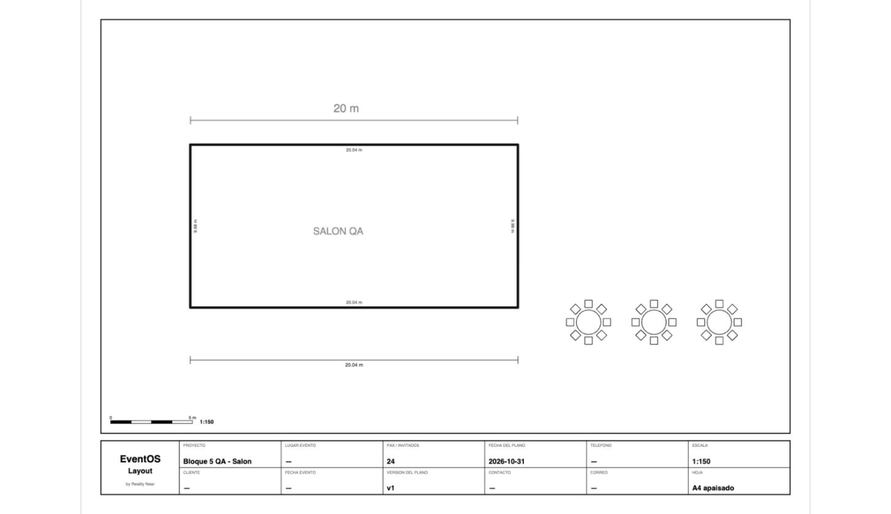

A3 apaisado, escala 1:100 — 30 KB:

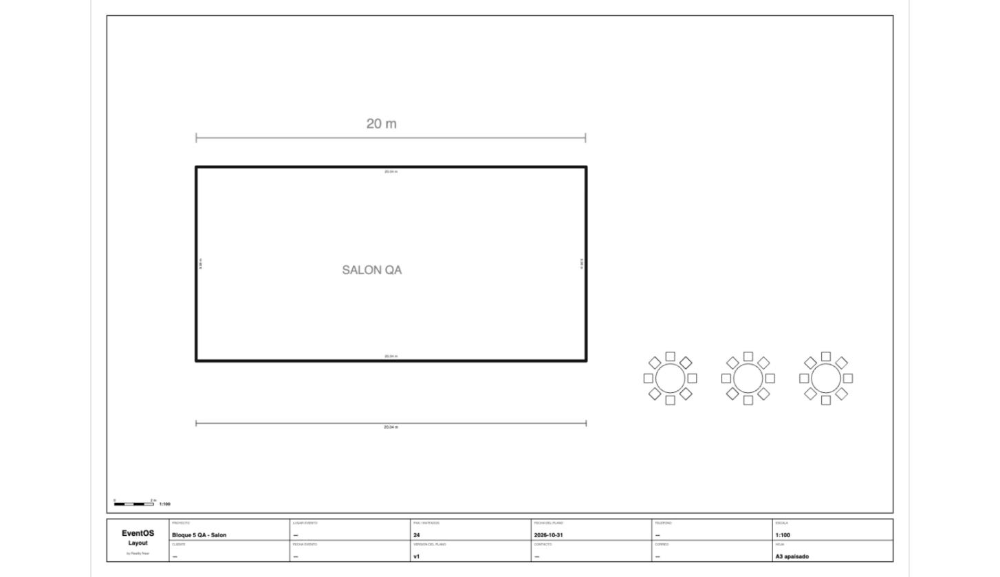

Lo seleccionado (3 mesas con sus sillas), escala 1:50, con el cajetín — 7 KB:

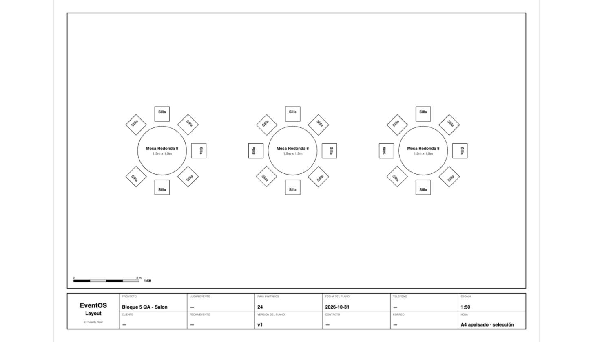

PNG de lo seleccionado (una mesa con sus sillas) y el diálogo de exportar:

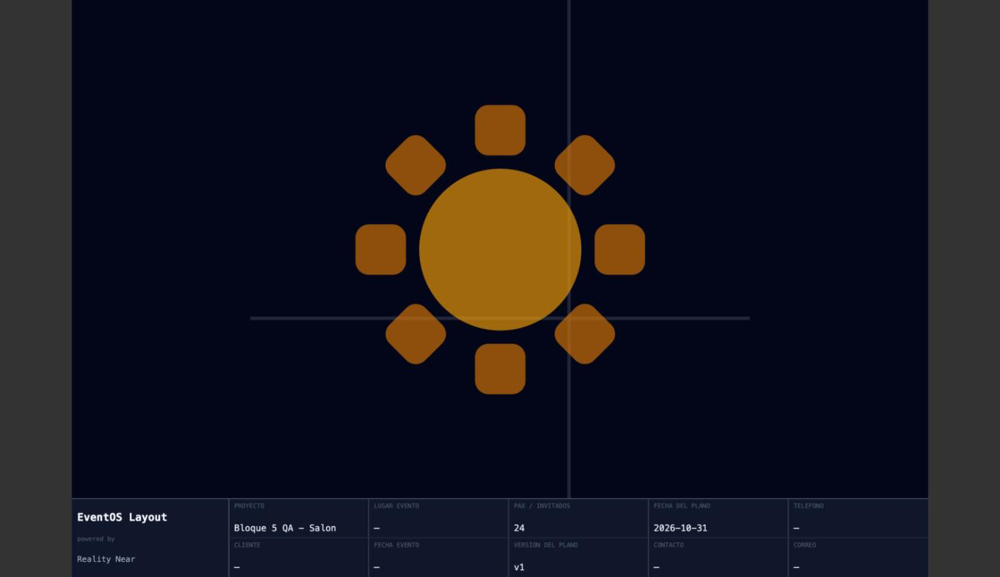

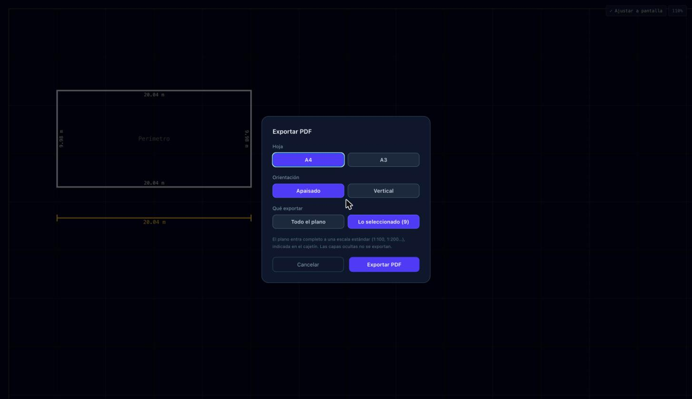

**Capturas del 3D:**

El plano más grande de JBD (913 piezas) a 120 cuadros por segundo:

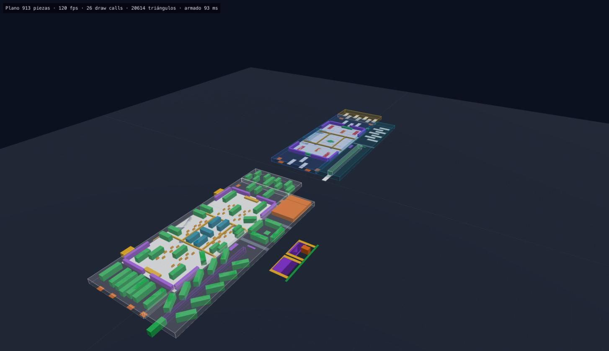

Plano QA: muros de 3 m, plano del local en el piso, mesas con sillas:

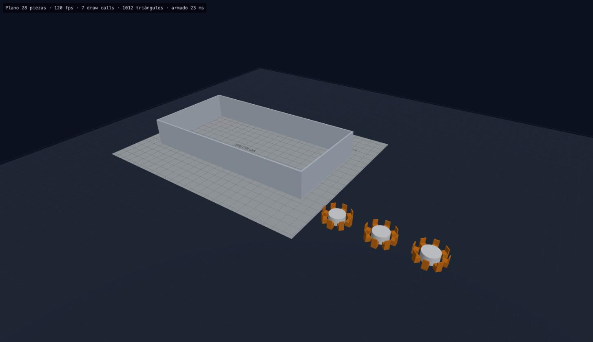

Recorriendo con W a la altura de una persona:

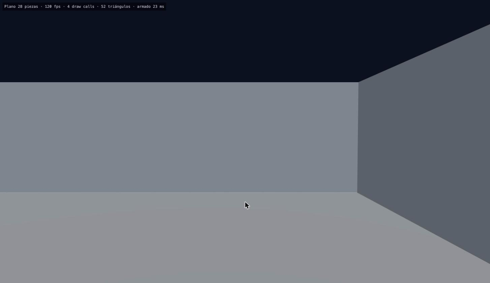

### Decidido en ausencia, revisar

1. **PDF vectorial** con jsPDF (`context2d` para las formas, texto con alineación propia porque `context2d` centra mal el texto rotado). Letra **Helvetica** en el PDF (antes monoespaciada).
2. **Hoja por defecto en dos claves sí/no** (`pdf_a3`, `pdf_landscape`): la validación de ajustes de la base no admite listas de valores.
3. Además de A4/A3 se puede elegir **vertical**; por defecto apaisado.
4. **Escalas estándar** de 1:20 a 1:10000; más allá, la escala se redondea al millar.
5. **Fondo en el PDF** como JPEG a 150 ppp mezclado con blanco; con "lo seleccionado", recortado a la zona elegida (no se agranda la hoja por el fondo entero).
6. **"Lo seleccionado"** incluye los dibujos y cotas que caen enteros dentro de la selección.
7. Si hay algo seleccionado, el diálogo viene marcado en **"Lo seleccionado"**. PNG sin selección exporta directo (como antes, la vista actual); con selección, pregunta.
8. **PNG de lo seleccionado** con el mismo estilo oscuro de pantalla, agrandado hasta el ancho del cajetín.
9. El **visor de versiones** exporta el PDF con la hoja por defecto de la org, sin diálogo.
10. En el PDF, el **nombre y las medidas** de una pieza solo se escriben si entran dentro de ella.
11. La **vista 3D se abre en otra pestaña** (máximo aislamiento) con una copia del plano en el navegador (vale 30 minutos), en vez de un panel dentro del editor.
12. **Three.js sin react-three-fiber** (menos peso y menos dependencias). Versión 0.186.1 (la 0.187.0 salió ayer).
13. **Alturas en 3D:** muros 3 m; curvas abiertas 2,4 m; escenario 1 m; LED 3,5 m; pantalla 3 m; barra 1,1 m; mesas 0,75 m; sillas 0,45 m + respaldo; baños y cocina 2,5–2,6 m; vallas 1,1 m; formas sueltas y circulación como marcas de 5 cm en el piso; estructuras de más de 40 m² translúcidas.
14. En esta primera versión **no hay choques** al recorrer (se atraviesan paredes) y **los dibujos y cotas no aparecen** en 3D.
15. **Arreglado de paso** (bloque 7): el doble clic que termina un muro, polígono o curva perdía el último punto.

**Nada grande ni irreversible quedó decidido.** Lo único que requiere a Javier es volver a iniciar sesión en QA para repetir las pruebas en la app.

### Parte A del pedido del 2026-11-01 — Recorte del fondo, alturas 3D, luz y mantel

**1. Recortar el plano del local.** En "Plano del local" → **✂ Recortar**: se arrastra sobre la imagen original para quedarse con el área útil (sin cajetín, logos ni márgenes del arquitecto). "Quitar recorte" vuelve a la imagen entera.
- El archivo original no se toca: el recorte (0–1 de la imagen) va en `meta.background.crop`, así que entra en las versiones. La parte recortada queda **en el mismo lugar del plano** (recortar no mueve el dibujo; volver a recortar parte siempre de la imagen entera; calibrar un fondo recortado conserva el recorte).
- Se aplica en el editor, el PNG, el PDF (el JPEG del fondo se toma del recorte) y el 3D (textura recortada).

**2. Alturas reales en 3D.** Cada pieza tiene un **tipo** (mesa, silla, tarima, pista, barra, pantalla, muro, carpa, módulo de servicio, valla, torre/truss, vehículo, otra pieza) y la altura de cada tipo es **ajuste de la org** (Administración → Organización → Layout → "Alturas en la vista 3D"; migración `20261101090000`, claves `h3d_*`, desde la versión viva de `org_settings_schema()` con candado md5; ROLLBACK: valores por defecto, owner guarda, negativo y texto rechazados, viewer rechazado, otros grupos idénticos). En **Propiedades → Altura 3D** se puede escribir otra para una pieza (vacío = la del tipo, que se muestra como sugerencia).
- Por defecto (m): mesa 0,75 · silla 0,9 (asiento 0,45) · tarima 0,6 · pista 0,05 · barra 1,1 · pantalla 3 · muro 3 · carpa 3 (translúcida) · servicios 2,6 · vallas 1,1 · torres 6 · vehículos 3 · otras 0,9.
- El tipo sale de la forma, la categoría y palabras del nombre en español e inglés ("Mesa de dulces" → mesa, "Escenario 23 x 5" → tarima, "Pantalla Led" → pantalla, "Camion" → vehículo, "Torre" → torre).
- **Las zonas grandes** (estructuras de más de 150 m², como las "Zona 1/2/3" de 107 × 37 m del plano más grande de JBD) y las formas sueltas quedan como **marcas en el piso** en lugar de bloques de 3 m. Era el "bloque grande" demasiado alto.

**3. Luz del 3D.** Cielo gris azulado claro, luz de ambiente pareja con un sol suave y piso claro con la grilla bien visible. El plano del local en el piso con más presencia.

**4. Color de mesas → mantel.** El 3D pintaba **todas las mesas con un gris fijo** (`#e5e7eb`) e ignoraba su color: corregido.
- El color de una mesa es el color del **MANTEL**: en Propiedades de la mesa, sección **"Mantel"** con color y **tipo/tela** opcional (sugerencias: Hasta el piso, Corto, Lino, Satén, Spandex…). En 3D, el mantel largo llega al piso y el corto deja ver el pie. El color sale en el canvas, PNG y PDF.
- **Sillas:** sección **"Silla"** con **tipo** (Tiffany, Crossback, Plegable, Phoenix, Ghost… o texto libre) y color.
- **Un conjunto mesa + sillas se cambia entero:** al elegir la mesa de un conjunto (o una selección), aparece "Mesas: N · sillas: M. Se cambian todas de una vez" con mantel (color, tipo/tela) y sillas (tipo, color). Una entrada de deshacer.

**Pruebas:** 13 tests nuevos (alturas por tipo con nombres reales, zonas como piso, altura de la org y la escrita a mano, mantel y sillas del conjunto, lo bloqueado no cambia, recorte en el mismo lugar, quitar recorte, recorte que es la imagen entera, calibrar recortado). Total en Layout: 120; Administración: 119.
- **En la app real** (la sesión del navegador ahora es la cuenta de Javier en JBD, así que **solo mirando**, sin guardar nada):
  - `/3d/` del plano más grande de JBD: escena clara, zonas planas en el piso, vehículos a 3 m, 120 cuadros por segundo.
  - Plano nuevo **sin guardar** (no escribe en la base): mesa de 10 con sillas → mantel blanco "Satén corto", sillas Tiffany moradas desde la sección del conjunto → en 2D y en "Ver en 3D" la mesa sale blanca y las sillas moradas.
  - De paso, **el diálogo de exportar y el PNG/PDF de la selección en la app real** (pendiente del bloque 8): A4 apaisado por defecto, "Lo seleccionado (11)", "Layout - v1.pdf" de 6 KB y "Layout - v1.png" de 131 KB, sin errores.
- **El recorte** se probó con páginas locales que montan los módulos reales (canvas, PDF, 3D y el diálogo) con el fondo del plano QA, porque subir un fondo en la sesión de JBD sería escribir en JBD. Falta probarlo de punta a punta en QA cuando vuelva esa sesión.

Capturas:

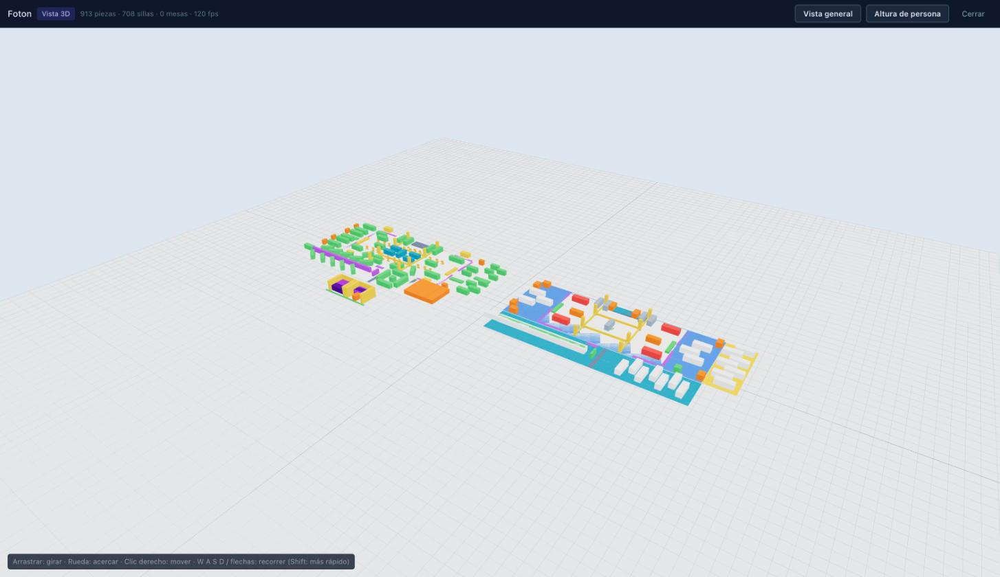

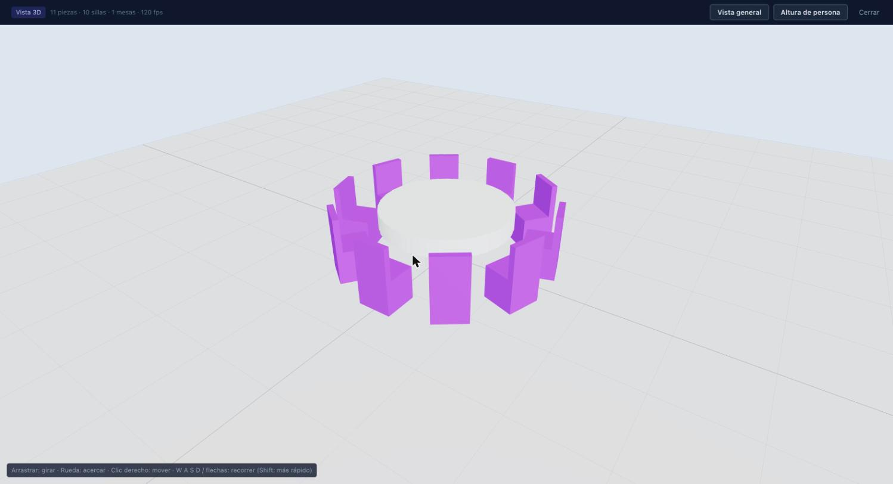

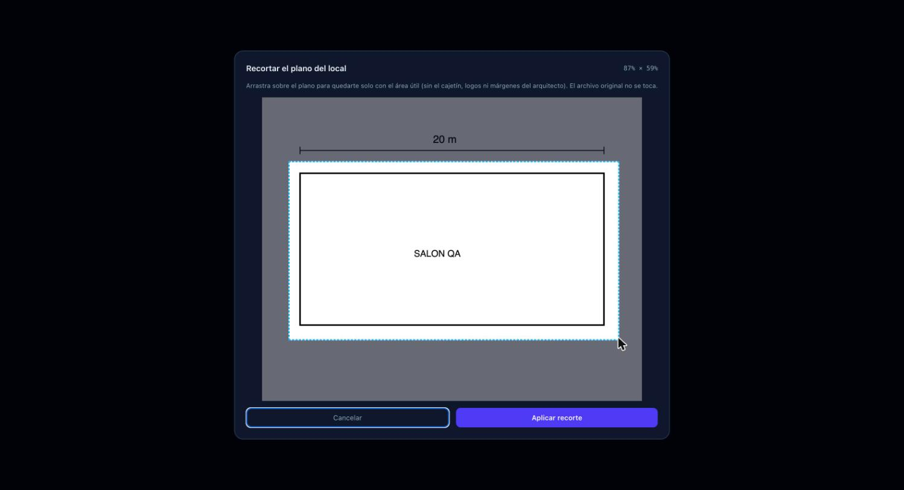

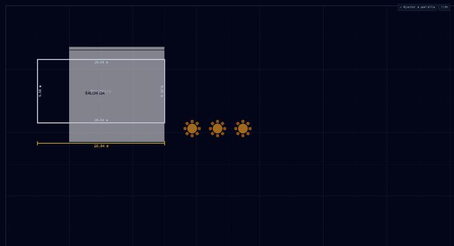

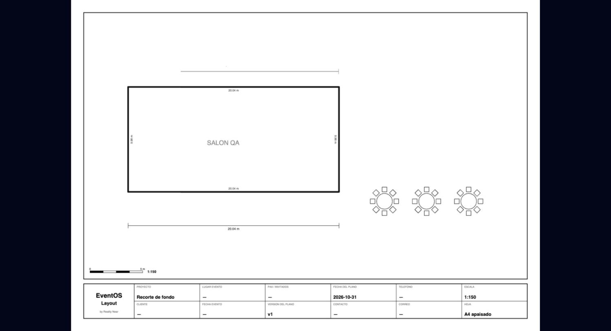

**Decidido sin preguntar (menor, revisar):** el color de la mesa *es* el del mantel (no un campo aparte); tipo de silla y tipo/tela del mantel como texto libre con sugerencias (no una lista cerrada); "corto" en el texto del mantel cambia el 3D; las zonas de más de 150 m² se dibujan en el piso; el tipo de pieza se deduce del nombre.

---

## 6.1 Decisiones de Javier sobre los bloques 1 y 2 (2026-10-31, segunda tanda)

Responden la lista de la §7. Donde la §7 tenía una recomendación y Javier no dijo otra cosa, **vale la recomendación**.

| # | Tema | Decisión |
|---|---|---|
| 1 | Viewer | Aparece en Administración → Roles y permisos, **solo con "ver"** en Layout. |
| 2 | Plantillas y encabezado | Plantillas de plano por organización: **sí**. Encabezado **"EventOS Layout"**, sin el sello "MVP". |
| 3 | Mesas y sillas | Medidas por defecto de la §7 (silla 0,45 m; mesa redonda de 8 = 1,5 m, de 10 = 1,8 m, de 12 = 2,1 m; rectangular 2,4 × 0,75 m; 0,15 m entre silla y mesa), pero **guardadas como ajustes de la org** en `organizations.settings.layout` y editables en Administración. **PAX automático**, con opción de escribirlo a mano. La **separación entre mesas** (1,5 m) también es ajuste de la org. |
| 4 | Plano del local | Fondo en imagen o PDF, muros de 0,15 m y cotas con 2 decimales, **todo como ajuste de la org**. |
| 5 | Biblioteca y capas | La biblioteca es **la de la organización**. **Capas fijas** al inicio. Publicar en la biblioteca es una **facultad nueva** en Roles y permisos (owner y admin por defecto). |
| 6 | Curvas | **Arcos y medias lunas primero**; curvas libres (Bézier) después. |
| 7 | PDF | El usuario **elige A4 o A3** al exportar. Por defecto **A4 apaisado** (el tamaño por defecto también es ajuste de la org). Escala automática. **El cajetín va siempre**, también al exportar solo lo seleccionado. |
| 8 | 3D | Se levanta la prohibición de Three.js **solo para la ruta "Ver en 3D"**, cargada al tocarla y aislada del editor. **Primera versión:** formas simples generadas en código con las medidas reales, sillas y mesas instanciadas, **sin descargar modelos**. Los modelos descargados vienen más adelante, **solo CC0** (Kenney, Poly Haven, Quaternius, Poly Pizza) y solo para piezas especiales. **Render con IA: después.** No se contrata ni configura ningún proveedor pago. |
| 9 | Resto | Se aplican las recomendaciones de la §7: Viewer solo "ver"; `custom_assets` protegido en el bloque 6; encabezado en el bloque 3; muros con grosor editable; capas iniciales perímetro/estructura, mobiliario, decoración, técnica y notas; assets personales que se pueden compartir con la org; DEC-0020 reemplazada solo para el módulo 3D; Inventarios: primero solo sugiere. |

**Ajustes de la org para Layout** (`organizations.settings.layout`, regla del 2026-10-29: nunca tablas de ajustes nuevas). Cuando se construyan, estas son las claves previstas, con su valor por defecto:

| Clave | Por defecto | Bloque |
|---|---|---|
| `chairSize` | 0,45 m | 4 |
| `tableRound8` / `tableRound10` / `tableRound12` | 1,5 / 1,8 / 2,1 m | 4 |
| `tableRect` | 2,4 × 0,75 m | 4 |
| `chairGap` | 0,15 m (silla–mesa) | 4 |
| `tableSpacing` | 1,5 m (entre mesas al repetir) | 4 |
| `wallThickness` | 0,15 m | 5 |
| `dimensionDecimals` | 2 | 5 |
| `backgroundFormats` | imagen y PDF | 5 |
| `clientHide*` (Vista cliente) | técnica y notas | 6 |
| `pdf_a3` / `pdf_landscape` (hoja del PDF) | A4 apaisado | 8 |

**Siguiente:** nada pendiente de construir. Hechos: bloques 3 a 8, primer paso del 9, parte A del 2026-11-01 (recorte, alturas 3D, luz, mantel) y L1 simple (lista de materiales). L2–L5 en espera (§8).

---

## 7. Decisiones pendientes por bloque (lista completa, orden nuevo)

> **Resueltas el 2026-10-31** (ver §6.1). Se deja la lista como registro.

**1. Permisos (hecho)**
- ¿Agregar **Viewer** a la matriz de Administración → Roles y permisos? Hoy esa pantalla no lo muestra, así que no hay forma de darle el módulo Layout desde ahí. *Recomiendo:* sí, mostrarlo solo con "ver".
- Proteger `custom_assets` (que es por usuario y permite suplantar `created_by`). *Recomiendo:* hacerlo en el bloque 6, junto con la biblioteca de la org.

**2. Arreglos rápidos (hecho)**
- ¿Plantillas de plano por org (boda 100, corporativo, cóctel)? *Recomiendo:* sumarlas al bloque 6 (biblioteca de la org).
- ¿Cambiar el encabezado a "EventOS Layout" y sacar "MVP"? *Recomiendo:* sí, en el bloque 3.

**3. Ordenar el código del canvas**
- Sin decisiones. Lo que ve el usuario no cambia.

**4. Mesas con sillas y PAX**
- Medidas por defecto. *Recomiendo:* silla 0,45 m; mesa redonda de 8 = 1,5 m, de 10 = 1,8 m, de 12 = 2,1 m; rectangular 2,4 × 0,75 m; 0,15 m entre silla y mesa.
- ¿PAX automático o solo sugerido? *Recomiendo:* automático (cuenta las sillas dibujadas), con opción de escribirlo a mano.
- Separación por defecto al repetir en grilla. *Recomiendo:* 1,5 m entre mesas, editable.

**5. Plano del local y cotas**
- Formatos de fondo. *Recomiendo:* imagen y PDF ahora; DWG/DXF después.
- ¿Muros con grosor? *Recomiendo:* sí, 0,15 m por defecto y editable.
- Precisión de las cotas. *Recomiendo:* metros con 2 decimales.

**6. Capas y biblioteca de la organización**
- Confirmar la lectura del mensaje cortado (§0, nota 1).
- ¿Capas fijas o propias de cada org? *Recomiendo:* fijas al inicio (perímetro/estructura, mobiliario, decoración, técnica, notas) y editables después.
- ¿Quién publica en la biblioteca de la org? *Recomiendo:* una facultad nueva "Compartir" en Layout, con owner y admin por defecto.
- ¿Los assets personales siguen existiendo? *Recomiendo:* sí. Cada uno se puede "compartir con la org".

**7. Curvas**
- ¿Arcos primero o Bézier primero? *Recomiendo:* arcos y medias lunas primero (escenarios, backings, sillas de ceremonia); Bézier después.

**8. PDF profesional**
- Tamaño y escala por defecto. *Recomiendo:* A3 apaisado; escala automática de las estándar (1:100, 1:200, 1:500) que entre en la hoja.
- ¿Exportar la selección lleva cajetín? *Recomiendo:* sí.

**9. 3D**
- ¿Levantar la exclusión de Three.js (DEC-0020) solo para el módulo 3D cargado aparte? *Recomiendo:* sí (ver §3.1–3.3).
- Alturas por defecto por tipo. *Recomiendo:* la tabla de la §3, opción A.
- ¿Modelos libres (CC0) o un pack pagado? *Recomiendo:* libres primero.
- Render con IA: proveedor y tope mensual. *Recomiendo:* modelo abierto alojado, con tope de US$ 50/mes.

**Después (sin número todavía)**
- Lista de materiales e Inventarios: ¿reserva desde el plano o solo sugiere? *Recomiendo:* que primero solo sugiera.

---

## Anexo — cómo se obtuvo

- **Código:** `frontend/src` al commit `89c254a` y las migraciones en `supabase/migrations`.
- **Datos:** consultas de solo lectura y en agregado (conteos por nombre, forma, categoría, rotación, vértices y dibujos) sobre `public.layouts`, `custom_assets` y `eventos.events` del proyecto `rn-layout-engine-v2`. Ningún UPDATE ni INSERT en JBD.
- **Navegador:** sitio de producción con la cuenta QA (`jbambaren@mettal.io`, org "QA Superadmin — Aprobar"). El plano de prueba no se guardó. La sesión se cerró al terminar.
- **No medido:** el rendimiento real con 900+ piezas (QA no tiene un plano de ese tamaño). Queda como tarea del punto 12 de §4.

---

## 8. Del plano a la lista de materiales — auditoría y propuesta (2026-11-01)

> **Decisión de Javier (2026-11-01):** la cadena completa (L2–L5) es sobreingeniería para esta etapa, porque muchas orgs alquilan a terceros y no reservan de un inventario propio. Se construyó **solo una versión simple de L1** (ver §8.4). **L2, L3, L4 y L5 quedan EN ESPERA: retomar cuando haya uso real.** No se tocó Inventarios ni Ventas.

**Objetivo:** que el plano cuente lo que hay (sillas por tipo y color, mesas por tipo, manteles por color y tela, tarimas y pista en m², barras en metros, etc.) y arme la lista que va a **Inventarios** (reserva para el evento) y a **Ventas** (presupuesto).

### 8.1 Qué hay hoy (revisado en la base, solo lectura)

| Módulo | Qué existe | Lo que importa para esto |
|---|---|---|
| **Layout** | Piezas con nombre libre (`elements` en `public.layouts`), categoría, medidas, y desde hoy tipo de silla, mantel (color + tipo/tela) y conjuntos mesa+sillas. Biblioteca por org (`custom_assets`). Versiones (`layout_versions`, v1, v2…). El plano se vincula a un evento (`eventos.events.layout_id`). | **Ninguna pieza está vinculada a un ítem de Inventarios.** Los nombres varían por org ("Round Table 8" usado como silla, "Mesa de dulces", "Camion"). |
| **Inventarios** | `inventarios.items` (stock total/actual, fuera de servicio, `unit`, `precio_alquiler`, proveedor), `reservations` (por ítem y evento, con fechas; estados pending / confirmed / returned / cancelled / expired), `movements`, `providers`. La base **rechaza una reserva sin stock** (trigger `check_reservation_availability`, error INV020 con quién tiene comprometidas las unidades) y calcula disponibilidad por fechas con días de margen (`calc_disponibilidad`, ajuste `reservation_buffer_days`). Confirmar una reserva hace la salida (`cambiar_estado_reserva`). | Ya resuelve stock y conflictos de fechas. **Las reservas no guardan de dónde vienen** (no hay columna de origen), así que no se puede saber cuáles creó un plano. |
| **Ventas** | `ventas.quotes` con código y **versión** (borrador / enviado / aprobado / rechazado), `quote_items` (cantidad, precio unitario, sección, `origen`), foto del aprobado (`quote_approvals`), historial (`quote_change_log`). **El aprobado está bloqueado en la base** (VEN030/VEN031: "crea una versión nueva"). El evento apunta a su presupuesto (`events.quote_id`). | El bloqueo ya existe: Layout nunca podría tocar un aprobado aunque quisiera. Hay que **proponer una versión nueva**. |
| **Eventos** | Orden de trabajo (`work_order_sections/items`, con proveedor). | Destino natural de lo que se alquila a terceros y del armado. |

### 8.2 Propuesta

**a. Pieza → ítem de Inventarios (mapeo por org).** Sí hace falta: los nombres de Layout no son los de Inventarios y cambian entre orgs.
- Tabla nueva **`public.layout_item_links`** (por org): *qué pieza* (pieza del catálogo, asset de la biblioteca de la org, o una regla "silla tipo X color Y" / "mantel color X tela Y, mesa de 1,8 m") → *qué ítem* (`inventarios.items.id`) y *cuánto por pieza* (1 silla; un conjunto "mesa de 10" = 1 mesa + 10 sillas + 1 mantel; la tarima por m²; la barra por metro lineal).
- **Dónde se configura:** en Layout, biblioteca → "Vincular con Inventarios", con sugerencias por nombre parecido. Lo puede editar quien tenga Layout "editar" **e** Inventarios "ver" (para elegir ítems). Las piezas sin vincular aparecen en la lista como "sin vincular", nunca se descartan.

**b. Si no alcanza el stock.** Se usa `calc_disponibilidad` para las fechas del evento (con los días de margen de la org) y se muestra *necesario / disponible / falta*, con quién tiene comprometidas las unidades (ya lo da la base). Para lo que falta: **"Alquilar a proveedor"** (elegir de `inventarios.providers`, con su precio de alquiler). Esa línea **no se reserva** en el inventario propio: va a Ventas como costo y a la orden de trabajo del evento con el proveedor. La base ya impide reservar de más (INV020), así que nunca quedaría stock negativo por un plano.

**c. Versiones del plano (v3 → v4) sin duplicar.** Una **lista de materiales por evento**, atada a la versión del plano que la generó (`layout_material_lists` + líneas). Cada reserva creada desde la lista guarda su origen (**requiere una columna nueva en `inventarios.reservations`**: `origen = 'layout'` + id de la línea). Al pasar a v4 se calcula la **diferencia** contra la lista confirmada: se **ajusta la cantidad** de la reserva existente (o se cancela la que sobra), nunca se crea otra para el mismo ítem. Si la reserva ya salió del almacén (confirmada), no se toca: se avisa para que Inventarios decida.

**d. Ventas.** Desde la lista: "Enviar a presupuesto".
- Si el presupuesto del evento está en **borrador**: se agregan o actualizan las líneas con `origen = 'layout'` (cantidades del plano; los precios los pone Ventas con sus reglas).
- Si está **aprobado** (bloqueado): se ofrece **"Crear versión nueva del presupuesto"** (copia del aprobado + las diferencias, en borrador), mostrando qué cambia. **Nunca se toca el aprobado**; la base ya lo impide (VEN030).

**e. Quién confirma.** Nada se reserva solo. La lista nace en **borrador**; alguien con permiso la revisa y toca **"Confirmar y reservar"**. Propongo que lo pueda hacer quien tenga Inventarios **"crear"** (reservas); Layout solo arma y propone. Las reservas se crean como **pendientes**: la salida del almacén la sigue confirmando Inventarios como hoy.

### 8.3 Bloques propuestos

| # | Bloque | Qué incluye | Toca otros módulos | Esfuerzo |
|---|---|---|---|---|
| L1 ✅ | **Conteo en el plano** (versión simple, hecha) | Panel "Materiales": sillas por tipo y color, mesas por tipo y tamaño, manteles por color, tela y tamaño, tarimas y pista en m², barras en metros, el resto por pieza. Exportar en el PDF (hoja de materiales) y a CSV. Solo lee el plano. | No | 1 sesión |
| L2 ⏸ | **Vincular con Inventarios** *(en espera, retomar cuando haya uso real)* | `layout_item_links`, pantalla de vínculos en la biblioteca, sugerencias por nombre, permisos. | Lee Inventarios | 1–2 sesiones |
| L3 ⏸ | **Disponibilidad y faltantes** *(en espera)* | Necesario / disponible / falta para las fechas del evento; "alquilar a proveedor". | Lee Inventarios | 1 sesión |
| L4 ⏸ | **Lista confirmada y reservas** *(en espera)* | Lista por evento y versión del plano, "Confirmar y reservar" (pendientes), diferencias v3 → v4 sin duplicar. | **Escribe en Inventarios** (columna de origen en reservas; coordinar con la sesión de Inventarios) | 2 sesiones |
| L5 ⏸ | **Presupuesto** *(en espera)* | Líneas al borrador o versión nueva si está aprobado; orden de trabajo para proveedores. | **Escribe en Ventas y Eventos** (coordinar) | 1–2 sesiones |

**Decisiones que necesito antes de construir:**
1. ¿Empezamos por L1 (solo contar, sin tocar otros módulos)? *Recomiendo: sí.*
2. ¿Quién confirma la lista y reserva: Inventarios "crear", o una facultad nueva en Layout? *Recomiendo: Inventarios "crear".*
3. Unidades de tarima/pista/barra: ¿m² y metro lineal, o piezas estándar (tarima de 1,22 × 2,44 m)? *Recomiendo: lo dice el vínculo de cada ítem (por pieza, m² o metro).*
4. Lo que falta: ¿se alquila a proveedor desde Layout o solo se avisa y lo resuelve Inventarios? *Recomiendo: Layout propone, Inventarios/Producción confirma.*
5. Los cambios en Inventarios (columna de origen en reservas) y en Ventas (líneas con origen 'layout'): ¿los hago yo coordinando con esas sesiones, o los pido a cada módulo? *Recomiendo: los pide Layout y los hace cada módulo, para no pisar trabajo en curso.*

### 8.4 L1 simple — hecho (2026-11-01)

**Botón "📋 Materiales"** en el editor (también en solo lectura). Cuenta todas las piezas del plano, también las de capas ocultas, agrupadas por **tipo + variante**:
- **Sillas** por tipo y color ("Silla · Tiffany · Morado").
- **Mesas** por tamaño ("Mesa · Ø 1.8 m", "Mesa · 2.4 × 0.75 m").
- **Manteles** por color, tela y mesa ("Mantel · Blanco · Largo · Ø 1.8 m"). Solo cuentan los elegidos: color cambiado, nombre de color o tela.
- **Tarimas y pista en m²**, **barras en metros**.
- El resto, por nombre y medida.
- No cuentan los muros del local ni las marcas en el piso.

**Origen por línea:** propio / tercero, editable, con **nota** opcional (por ejemplo, el proveedor). Se guarda en el plano (`meta.materials`, por clave normalizada de la línea), así que va en sus versiones. "Propio sin nota" es lo de siempre y no se guarda.

**Exportar:**
- **PDF** A4 vertical con el cajetín del plano y, si son muchas líneas, varias páginas, cada una con su cajetín.
- **Excel** (.xlsx real, armado con fflate 0.8.3, que ya venía con jsPDF) con los datos del cajetín arriba.
- Nombre: "<Nombre> - vN - materiales.pdf/xlsx".

**Comparar con otra versión guardada** (por defecto la anterior): columna "Cambio vs vX" con +10, −1, "nuevo", y las líneas que **ya no están**. Va también en el PDF y el Excel.

**Colores y tipos:**
- **"Tipo de pieza"** explícito en Propiedades ("Automático (sugerido: Mesa)" o uno elegido). Manda sobre lo deducido por el nombre, que queda solo como sugerencia, y cuenta en la lista, en la altura 3D y en la sección Mantel/Silla.
- **"Nombre del color"** en mesas (mantel) y sillas: si no se escribe, se sugiere por el color ("Morado", "Dorado").
- Los textos se **normalizan** (mayúsculas, espacios y acentos no separan líneas: "Blanco" = " blanco " = "BLANCO") y se guardan en la forma ya usada en la org.
- **Lista de sugerencias por org:** función `public.layout_vocab(org)` (migración `20261101120000`, solo lectura, pide ser miembro con Layout). Devuelve tipos de silla, telas y nombres de color ya usados en los planos de la org. ROLLBACK: el owner de QA la ve; otra org y un viewer sin el módulo, rechazados. Aplicada y verificada.

**Pruebas:** 12 tests nuevos (normalizar, nombre de color, sillas por tipo y color con mayúsculas distintas, mesas y manteles, m² y metros, muros y zonas fuera, tipo elegido manda, comparar +10/−1/ya no está, sugerencias, origen por defecto, Excel válido con texto escapado y cantidades como número, PDF en varias páginas, nombre del archivo). Total en Layout: 132.
- **En la app real** (la sesión del navegador es la cuenta de Javier en JBD, **solo mirando**):
  - Plano de JBD con 6 versiones: la lista contó 13 líneas y la comparación con v5 mostró +17 sillas, +2 mesas de Ø 1.8 m y lo nuevo. PDF ("… - v6 - materiales.pdf", 5 KB) y Excel (3 KB) se generaron interceptados, sin descargar ni guardar nada.
  - Plano nuevo **sin guardar**: "tiffany" quedó "Tiffany" y "  morado " quedó "Morado". Sillas como "Tercero" con nota "Alquileres Lima" y siguen así al cerrar y volver a abrir.
- **Ojo:** mientras miraba ese plano de JBD apareció su **v6** (00:34 UTC) y luego un borrador con 12 piezas más. **No fue esta sesión**: yo solo abrí la lista y exporté interceptando. La v6 suma 23 piezas a la v5, así que es alguien editando con la cuenta de Javier en ese momento.

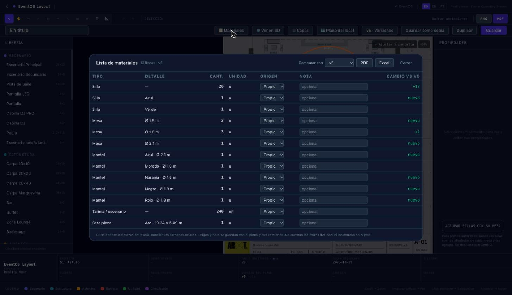

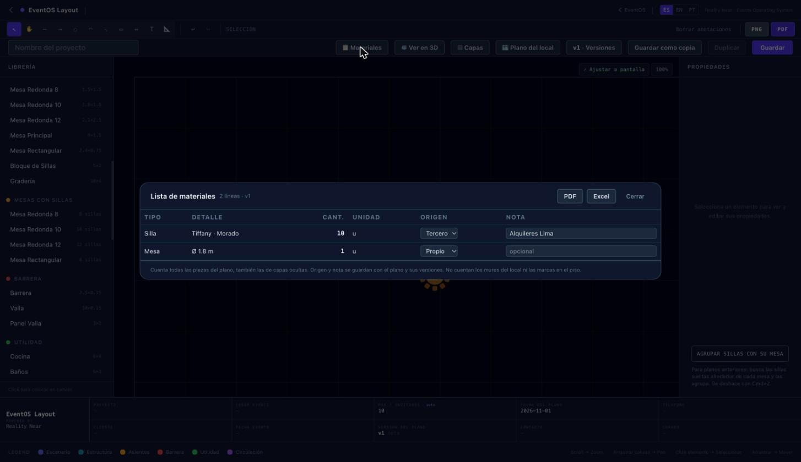

**Decidido sin preguntar (menor, revisar):** el origen por defecto es "propio"; los manteles solo cuentan si se eligió color o tela; tarima y pista se agrupan por tipo (no por nombre) para dar el total en m²; la comparación es contra versiones guardadas (por defecto la anterior a la actual).

### 8.5 Ajustes a la lista de materiales (2026-11-01, después de la revisión de Javier en un plano real)

1. **Comparación sin cambios:** "Sin cambios respecto a vN" en pantalla, PDF y Excel (antes la columna quedaba vacía).
2. **Avisos de lo que falta:** "Manteles sin definir: N" (las mesas sin mantel cuentan en una línea "Mantel · Sin definir · Ø …"), "Sillas sin tipo/color: N", y en cada silla "Sin tipo/color", "Sin tipo · Azul" o "Tiffany · sin color" en lugar de vacío o "—". En pantalla, PDF y Excel. Los avisos se calculan sobre lo que se exporta (el PDF de un proveedor no arrastra avisos del resto).
3. **Subtotal por tipo** al final de cada grupo: "Sillas: 34", "Mesas: 6", "Manteles: 5 + 1 sin definir", "Tarima / escenario: 240 m²", "Barra / buffet: 9 m".
4. **Título** del PDF y del Excel: "Lista de materiales — <Nombre> · vN" (y "· <Proveedor>" en el archivo de cada proveedor).
5. **Filtro al exportar** (PDF ▾ / Excel ▾): Todo · Solo propio · Solo terceros · Un archivo por proveedor (con su nombre en el título y en el archivo: "<Nombre> - vN - materiales - <Proveedor>.pdf").
6. **Tipo "Sofá / lounge"** (sofá, lounge, puff, sillón), con su altura 3D como ajuste de la org (`h3d_lounge` 0,8 m; migración `20261101150000`, desde la versión viva de `org_settings_schema()` con candado; ROLLBACK como las anteriores) y campo en Administración. Las piezas "Zona Lounge" de 1 × 0,8 y 2 × 0,8 m ahora salen como "Sofá / lounge". Lo que queda en **"Otra pieza"** se marca en ámbar en la lista con **"Elegir tipo…"**, que fija el tipo de todas las piezas de esa línea (una entrada de deshacer).
7. **Tercero con proveedor del catálogo:** la nota sugiere los proveedores de la org (`inventarios.providers`, **solo lectura**, la RLS ya deja leer a los miembros). Si lo escrito coincide con uno (sin importar mayúsculas), se guarda vinculado (`providerId`, marca ✓); si no, queda como texto libre. Reuniones no tiene un catálogo propio: el único es el de Inventarios. No se modificó nada de Inventarios.

**Pruebas:** 5 tests nuevos (sillas sin tipo/color, lounge y piezas por línea, subtotales con sin definir, filtros por origen y proveedor, sin cambios). Total en Layout: 137; Administración: 119.
- **En la app real** (sesión de Javier en JBD, solo mirando): en el plano "Prueba nueva version Layouts" v9 comparado con v8 aparecieron "Sin cambios respecto a v8", "Manteles sin definir: 1", "Sillas sin tipo/color: 26", los subtotales y "Sofá / lounge" (4 + 2). En un plano nuevo **sin guardar**: el catálogo de JBD trajo 3 proveedores; escribir uno en minúsculas lo dejó vinculado con su nombre exacto.
- **PDF por proveedor y Excel** se revisaron en una página local que monta el panel real con los datos de ese plano (leídos de la base, sin guardar): PDF completo con avisos y subtotales; un archivo por proveedor ("… - materiales - Alquileres Lima.pdf", "… - Mesas SAC.pdf", y su .xlsx) solo con sus líneas.

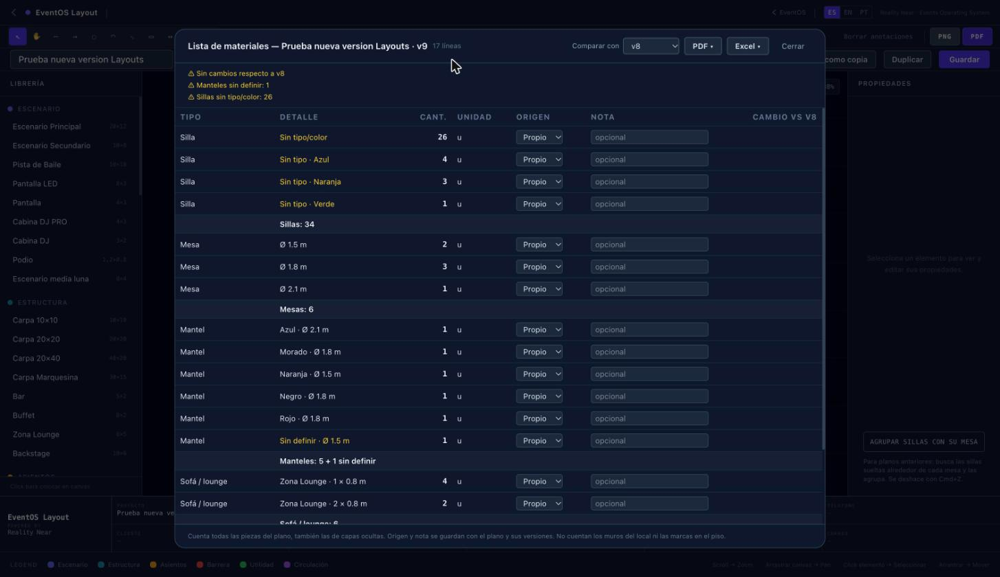

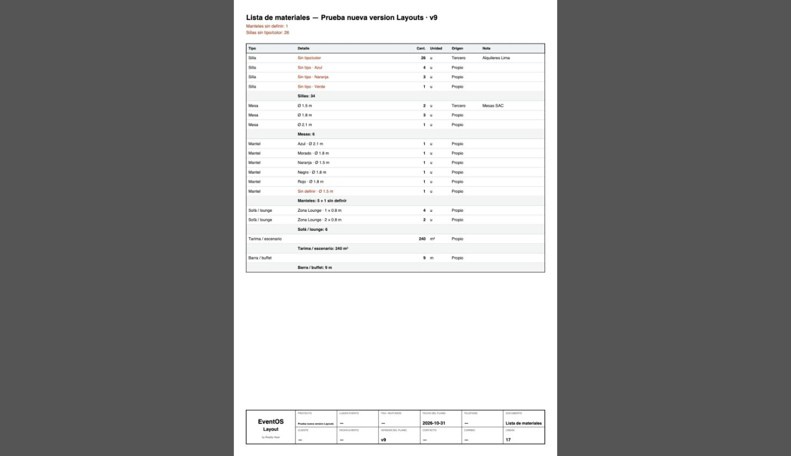

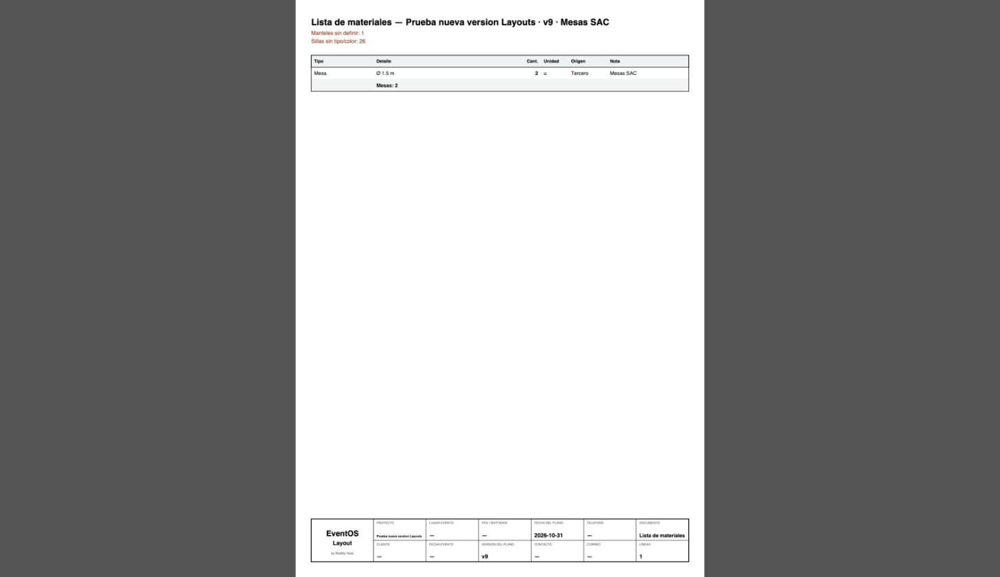

**Pregunta 8 — ¿el bloque 7 incluyó curvas libres?** Sí. Además de arcos y medias lunas, el bloque 7 trae **curvas libres**: la herramienta **Curva (B)** dibuja una curva suave que pasa por los puntos marcados (Bézier armadas desde los puntos), abierta o cerrada; y en Propiedades cualquier lado de un polígono, muro o curva se puede convertir en **"Curva libre"**. Lo que **no** tiene todavía: mover vértices ni manijas con el mouse (se edita por lados en Propiedades y con el recuadro).

